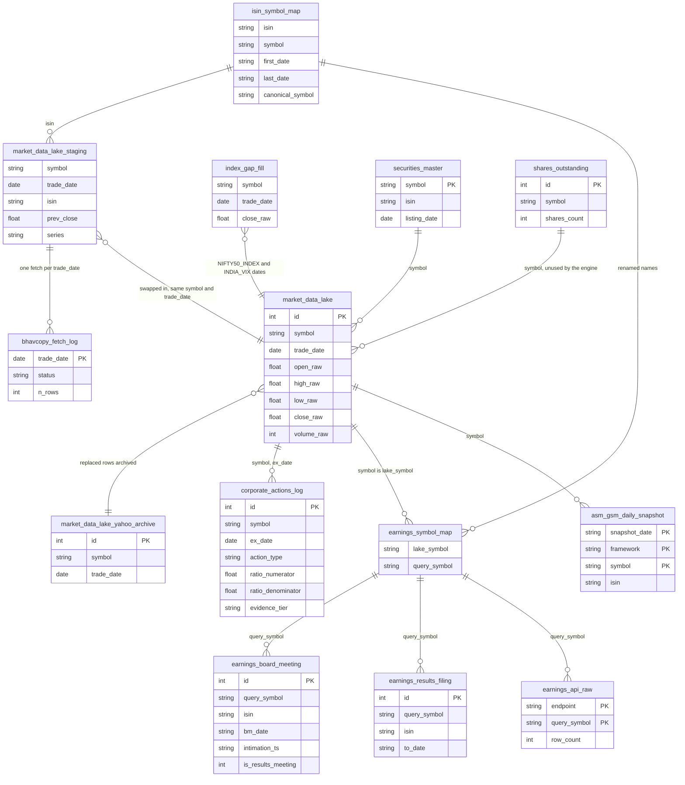
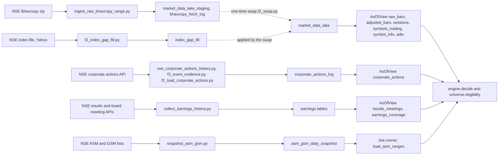
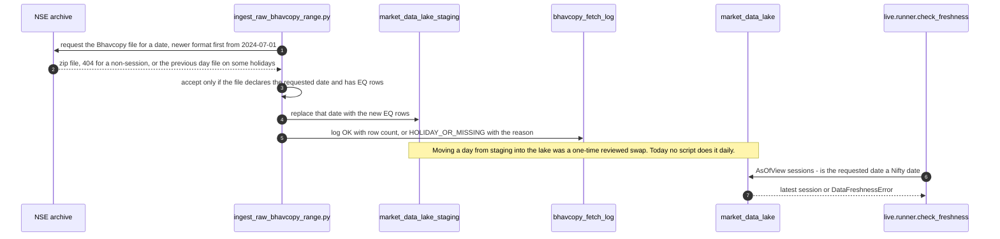
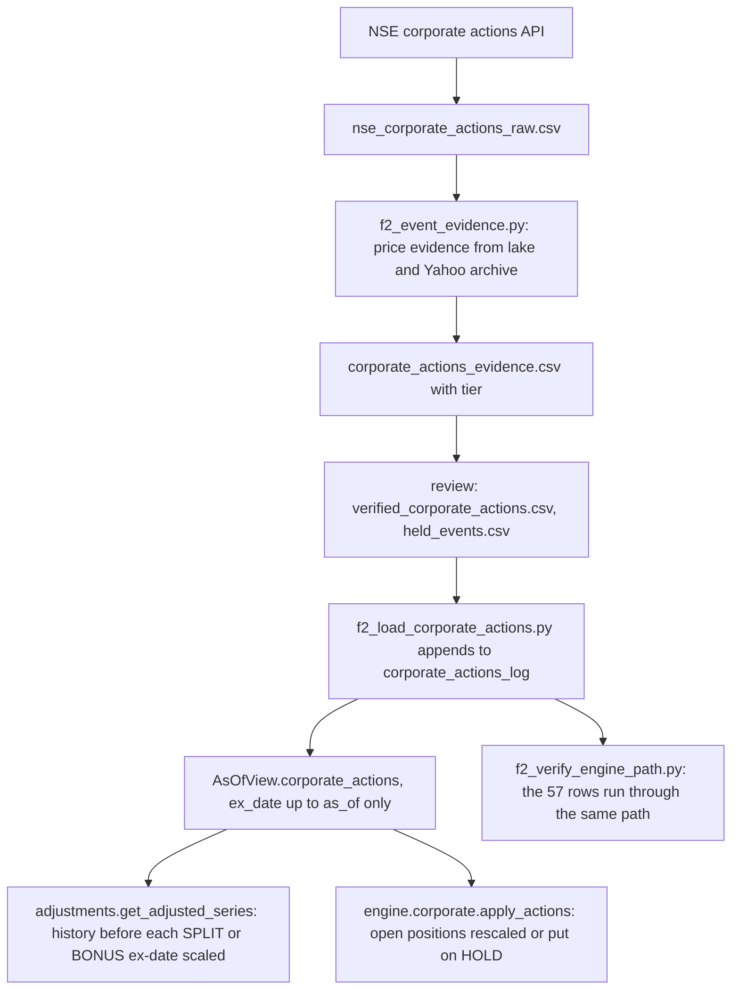
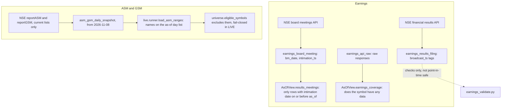
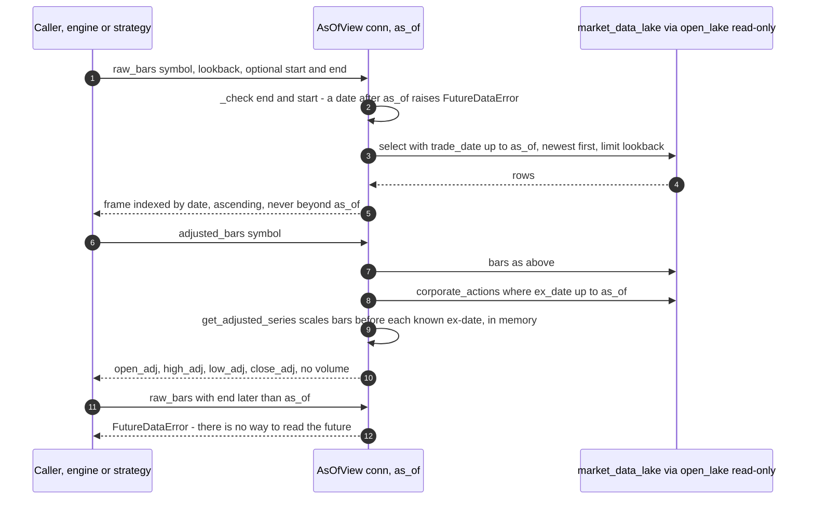

# StockBot data guide

A reading guide to every database and data file in the project, written from the real `finsight.db` and from the code, for the owner. Plain words first, exact names after. It describes what exists; it makes no recommendation and designs nothing.

**How the numbers in this guide were obtained.** Unless a line says "from report ...", every number was measured on **2026-11-09** from `finsight.db` as it stood then (file modified 2026-11-08 12:38:02, size 3,432,767,488 bytes) by `py scripts/gen_data_catalogue.py` (which writes `docs/guides/data_catalogue.md`, the full machine-measured catalogue: every column, every index, three sample rows per table) and by a few extra read-only queries. Numbers taken from an older written report say which report. To refresh the measured numbers, run the generator again; `tests/unit/test_guides_consistent.py` fails if a table in the database is missing from this guide.

Contents: A the databases and files, B inventory of `finsight.db`, C every table, D what a reader must know about the lake, E corporate actions, F coverage, G the live state database, H reference files, I known issues, J diagrams, K cheat sheet and queries.

---

## A. The databases and files in play

| what | where | size (measured 2026-11-09) | who writes it | who reads it | may the engine touch it? |
|---|---|---|---|---|---|
| **The lake**, `finsight.db` | `F:\Projects\Ravi\StockBot\finsight.db` (not in git) | 3,432,767,488 bytes | the ingestion tools (`stockbot/data/ingestion/`), the one-off tools in `scripts/provenance/`, and the older dashboard side (`stockbot/data/db/`, `stockbot/live/api/`, which can create tables and write the legacy tables) | `AsOfView` (read-only), `stockbot/data_checks/`, `stockbot/live/runner.py` (ASM/GSM snapshot, read-only), tests | **Read-only only**, through `stockbot.data.lake.open_lake` (SQLite `mode=ro` plus `query_only`). The engine, backtest, validation and the live adapter never write it. |
| **Live state**, `state/live_state.db` | `F:\Projects\Ravi\StockBot\state\live_state.db` | does not exist yet (the end-of-day run has never been run; `state/` is created by the first run and is git-ignored) | `stockbot/live/state_store.py` (through the live adapter only) | the adapter, `stockbot/live/health_check.py` | Not directly: the engine only sees the `State` object the adapter loads. The store refuses to open a file named `finsight.db`. |
| **ASM/GSM snapshot database** | `F:\Projects\Ravi\StockBotSnapshot\asm_gsm_snapshot.db` | 155,648 bytes | the frozen stand-alone script `snapshot_asm_gsm.py` in that same folder (not part of the repository) | `stockbot/data/ingestion/merge_asm_gsm_snapshots.py`, when you choose to merge it into the lake | No. Holds one snapshot day, 2026-11-08 (measured). |
| **Reference files** | `data/reference/*.csv` (and `f2_symbols.txt`), `data/f9/` | see section H | the scripts named in section H | the code named in section H | Some are read by the as-of view (`fund_etf_symbols.csv`) and the sector lookup (`sector_map.csv`); the rest by checks and tools. |
| **Trial ledgers** | `stockbot/validation/ledger/records/` | `trial_ledger.csv` 769 bytes, `trial_ledger_exploratory.csv` 275 bytes, `pre_registered_configs.yaml` 17,269 bytes | `stockbot/validation/ledger/__init__.py` (append-only) | `verify`, tests | No. Never edited; the exploratory ledger is pinned by a recorded sha256 and has no hash chain. |
| **Ticket files** | `state/tickets/tickets_<date>.json` | none yet | `stockbot/live/runner.py` (`write_tickets`) | the operator | No (output only). |
| **Backups** | `F:\Projects\Ravi\Backups\` | `F:\Projects\Ravi\Backups\finsight_pre_F2_2026-11-06.db` 1,005,137,920 bytes; `F:\Projects\Ravi\Backups\finsight_pre_step12_2026-11-08.db` 3,224,616,960 bytes; `F:\Projects\Ravi\Backups\finsight_pre_restructure_2026-11-08.db` 3,432,767,488 bytes (each with a `.sha256` file) | made by hand before risky steps | restore by hand | No. The `pre_restructure` backup's sha256 equals the current `finsight.db` (measured: both `dcade46506518a25d35f220e7e3b5b35d53c349362308ee42888cd9615ceb752`). |

Other generated files: `docs/guides/data_catalogue.md` (this guide's measured companion), `tests/golden/` (frozen results, read by tests), `docs/data_audit/*.csv` (reports from the data work). The older ORM layer reads `DATABASE_URL`, default `sqlite:///./finsight.db`, which is relative to the folder you run from; a stray empty database file exists in the git-ignored folder `data/db/` (it is not used).

---

## B. Inventory of `finsight.db`

Produced from `sqlite_master` on 2026-11-09 (see `docs/guides/data_catalogue.md`, section 1). **Views: none.** **Triggers: 2** (`trg_tal_no_update`, `trg_tal_no_delete`, both on `trade_analytics_log`, both raise "append-only"). **Tables: 25** plus SQLite's own `sqlite_sequence` (it stores the next id for tables with autoincrement ids). **Named indexes: 12**; the `sqlite_autoindex_*_1` entries are the indexes SQLite creates for each UNIQUE or composite primary key.

Named indexes: `idx_corp_symbol_date`, `idx_earnings_symbol`, `idx_mdl_symbol_date`, `idx_mdl_trade_date`, `idx_mdls_date`, `idx_mdls_isin`, `idx_positions_state`, `idx_positions_symbol`, `idx_securities_listing_date`, `idx_shares_symbol`, `ix_ebm_isin`, `ix_erf_isin`.

Status words: **core** = the engine or runner reads it; **ingestion** = bookkeeping of how data got in; **reference** = lookup data used by tools; **archive** = kept history; **legacy-dashboard** = used only by the older dashboard/paper-trading side that is not connected to the new engine (`docs/restructure/PRE_LIVE_LIST.md` item 7); **empty** = zero rows today; **unused** = nothing in the engine reads it.

| table | rows | purpose | written by | read by | status |
|---|---|---|---|---|---|
| `market_data_lake` | 5,634,334 | daily raw prices, one row per symbol per session, plus the Nifty 50 and India VIX series | `scripts/provenance/f2_swap.py` (the raw-price swap), `scripts/provenance/fix_blocker1_index_data.py`, `scripts/provenance/ingest_historical_2018_2019.py`; rows after 2026-09-30 appear to come from the older live pipeline (removed in the restructure) | `stockbot/data/asof.py` (`AsOfView`), `stockbot/data_checks/` | core |
| `market_data_lake_staging` | 5,599,040 | the raw Bhavcopy download before it was swapped into the lake | `stockbot/data/ingestion/ingest_raw_bhavcopy_range.py` | `f2_*` ingestion and check modules, `scripts/provenance/` | ingestion |
| `market_data_lake_yahoo_archive` | 2,829,905 | the old Yahoo-adjusted lake rows archived by the swap | `scripts/provenance/f2_swap.py` | `stockbot/data/ingestion/f2_event_evidence.py`, `scripts/provenance/f2_post_swap_checks.py` | archive |
| `bhavcopy_fetch_log` | 5,021 | one row per calendar date tried by the downloader, with outcome | `ingest_raw_bhavcopy_range.py` | `f2_build_isin_symbol_map.py`, `scripts/provenance/f2_validate_staging.py` | ingestion |
| `index_gap_fill` | 51 | Nifty 50 / India VIX rows for dates the lake lacked (special sessions, gaps) | `f2_index_gap_fill.py`, `f2_index_gap_fill_yahoo.py` | `scripts/provenance/f2_swap.py` | ingestion |
| `corporate_actions_log` | 22,997 | splits, bonuses, dividends, rights, mergers, demergers and other actions by ex-date, with an evidence tier | `stockbot/data/ingestion/f2_load_corporate_actions.py` | `AsOfView.corporate_actions`, `f2_engine_scan.py`, `f2_verify_engine_path.py` | core |
| `isin_symbol_map` | 853 | which symbol an ISIN used under which dates, and its canonical (latest) symbol | `stockbot/data/ingestion/f2_build_isin_symbol_map.py` | `f2_load_corporate_actions.py`, `collect_earnings_history.py`, `f2_engine_scan.py`, `f2_verify_list.py` | reference |
| `shares_outstanding` | 2,217 | one current shares count per symbol (not point-in-time) | `stockbot/data/ingestion/shares_outstanding_ingestor.py`, `scripts/provenance/fix_blocker2_shares_outstanding.py` | nothing in the engine (the view does not expose it) | unused (KI-001) |
| `securities_master` | 2,965 | NSE listed-securities list with listing dates | `stockbot/data/ingestion/securities_ingestor.py` | `f2_build_fund_symbols.py`, `scripts/provenance/` tools | reference |
| `earnings_symbol_map` | 3,258 | lake symbol to the symbol used in the NSE earnings APIs | `stockbot/data/ingestion/collect_earnings_history.py` | `AsOfView.earnings_coverage`, `results_meetings` | core |
| `earnings_board_meeting` | 164,819 | board-meeting announcements with the intimation timestamp; results meetings are flagged | `collect_earnings_history.py` | `AsOfView.results_meetings`, `earnings_coverage.py`, `earnings_validate.py` | core |
| `earnings_results_filing` | 173,410 | financial-results filings (periods, timestamps, XBRL link) | `collect_earnings_history.py` | `earnings_coverage.py`, `earnings_validate.py` (checks only) | reference |
| `earnings_api_raw` | 6,476 | the compressed raw API responses | `collect_earnings_history.py` | `AsOfView.earnings_coverage`, `earnings_coverage.py` | core (raw) |
| `earnings_collect_log` | 6,477 | one row per API call of the collection | `collect_earnings_history.py` | nobody | ingestion |
| `asm_gsm_daily_snapshot` | 253 | today's ASM and GSM surveillance lists, one row per name per framework per day | `stockbot/data/ingestion/snapshot_asm_gsm.py` | `stockbot/live/runner.py` (`load_asm_ranges`) | core |
| `asm_gsm_snapshot_raw` | 2 | the raw API response of each snapshot | `snapshot_asm_gsm.py` | nobody | ingestion |
| `asm_gsm_snapshot_log` | 2 | outcome of each snapshot call | `snapshot_asm_gsm.py` | nobody | ingestion |
| `asm_gsm_list` | 0 | older ASM/GSM list design | `stockbot/data/ingestion/asm_gsm_refresher.py` (not called) | nothing | empty, unused |
| `earnings_calendar` | 0 | older earnings-calendar design (NSE corporate-actions API) | `stockbot/data/ingestion/earnings_calendar_ingestor.py` (not called) | nothing | empty, unused |
| `regime_state` | 1,747 | daily macro regime (kill switch) state of the old strategy | the old regime filter (now `scripts/provenance/regime/regime_filter.py`) | `stockbot/live/api/regime.py` | legacy-dashboard |
| `pipeline_run_log` | 11 | one row per run of the old end-of-day pipeline | `stockbot/live/idempotency.py` | same, and `stockbot/live/api/health.py` | legacy-dashboard |
| `active_positions` | 0 | open positions of the old paper/live trading | `stockbot/live/position_service.py`, `stockbot/live/api/positions.py` | `stockbot/live/api/portfolio.py`, `stockbot/live/equity.py`, `stockbot/live/analytics_loop.py` | legacy-dashboard, empty |
| `trade_analytics_log` | 0 | append-only log of closed trades of the old paper/live trading | `stockbot/live/analytics_loop.py` | `stockbot/validation/trade_metrics.py`, `stockbot/live/api/analytics.py` | legacy-dashboard, empty |
| `daily_watchlist` | 0 | tickets of each old end-of-day run | the old pipeline (removed) | `stockbot/live/api/watchlist.py`, `stockbot/live/paper_report.py` | legacy-dashboard, empty |
| `account_ledger` | 0 | deposits and withdrawals | `stockbot/live/api/ledger.py` | `stockbot/live/account_ledger.py`, `stockbot/live/equity.py` | legacy-dashboard, empty |
| `sqlite_sequence` | - | SQLite internal: next autoincrement id per table | SQLite | SQLite | internal |

`shares_outstanding_pit` is **not** a table in the database: the point-in-time shares work (F2b) was closed on 2026-11-08 because it failed its pre-registered spot-check bar (from report: `data/reference/README_F2b_NOT_USED.md`, `docs/data_audit/DATA_KNOWN_ISSUES.md` KI-001). An ORM class of that name still exists in `stockbot/data/db/models.py` but no table was ever created.

---

## C. Every table

For each table: purpose, columns (type as declared in SQLite; "null?" = whether the column may be empty; example from the first non-empty row measured), keys and indexes, measured size and range, where the data came from, known issues. Three sample rows per table are in `docs/guides/data_catalogue.md` under the table's name; the core tables also show rows here. Dates are text `YYYY-MM-DD` unless a timestamp is stated.

### C.1 `market_data_lake`

**Purpose.** The heart of the system: daily **raw, unadjusted** open/high/low/close/volume for every NSE EQ-series symbol, plus two non-equity series, `NIFTY50_INDEX` and `INDIA_VIX`. Everything the engine knows about prices comes from here through `AsOfView`.

| column | type | null? | meaning | example |
|---|---|---|---|---|
| `id` | INTEGER | row id | surrogate key | 3599777 |
| `symbol` | TEXT | no | NSE symbol (renamed names are stored under the latest symbol, section D) | RELIANCE |
| `trade_date` | DATE | no | session date | 2013-01-01 |
| `open_raw`, `high_raw`, `low_raw`, `close_raw` | REAL | no | prices in rupees exactly as traded that day; never adjusted for splits | 844.0, 846.6, 839.1, 840.7 |
| `volume_raw` | BIGINT | no | shares traded (0 for index series) | 1561532 |
| `exchange` | TEXT | no (default `NSE`) | exchange | NSE |
| `created_at` | TIMESTAMP | yes (default now, UTC) | when the row was inserted | 2026-10-22 07:46:07 |
| `source` | TEXT | yes | provenance label; set on some index rows (`yahoo:^NSEI`, an NSE index-file URL); empty on the equity rows sampled (first and last day) | `yahoo:^INDIAVIX` |
| `loaded_at` | TEXT | yes | load timestamp of the F2 work; empty on most rows | 2026-11-07T16:32:25 |
| `source_symbol` | TEXT | yes | the symbol the row was published under, when it differs from `symbol` (renamed names) | empty in the rows sampled |

- **Keys/indexes.** UNIQUE (`symbol`, `trade_date`) via `sqlite_autoindex_market_data_lake_1`; `idx_mdl_symbol_date` (`symbol`, `trade_date`); `idx_mdl_trade_date` (`trade_date`).
- **Measured 2026-11-09.** 5,634,334 rows; 3,416 distinct `trade_date`; 3,627 distinct symbols (3,625 equity plus the two index series); first date 2013-01-01, last date 2026-10-16. Index series: `NIFTY50_INDEX` 2,710 rows from 2015-11-09; `INDIA_VIX` 3,077 rows from 2014-05-14. Equity rows 5,628,547.
- **Source.** The equity rows were produced by the F2 raw-price swap: `scripts/provenance/f2_swap.py` replaced the old Yahoo-adjusted rows (archived in `market_data_lake_yahoo_archive`) with raw NSE Bhavcopy rows from `market_data_lake_staging`, covering 2013-01-01 to 2026-09-30. Rows for 2026-10-01 to 2026-10-16 were appended afterwards; their `created_at` values (for example 2026-10-16 13:30:24 UTC, which is 19:00 IST) match the daily runs recorded in `pipeline_run_log`, so they appear to come from the older live pipeline, which was removed in the restructure (from report: `Claude_Docs/STOCKBOT_RESTRUCTURE_STOP5_REPORT.md`).
- **Rows.** `(3599777, 'RELIANCE', '2013-01-01', 844.0, 846.6, 839.1, 840.7, 1561532, 'NSE', '2026-10-22 07:46:07', NULL, NULL, NULL)`; `(2862073, 'RELIANCE', '2026-10-16', 1215.0, 1215.4, 1193.0, 1211.2, 17225283, 'NSE', '2026-10-16 13:30:24', NULL, NULL, NULL)`; `(2829906, 'NIFTY50_INDEX', '2020-01-01', 12202.15, 12222.2, 12165.3, 12182.5, 304100, 'NSE', '2026-10-02 06:58:37', NULL, NULL, NULL)`.
- **Known issues.** EQ series only (section D). Raw prices, so a split shows as a jump (SBIN: close 2910.5 on 2014-11-19, 297.1 on 2014-11-20). The Nifty series starts later than the equity rows (section D). The lake holds nothing after 2026-10-16. 934 equity symbols have their last bar before the last session (measured), see section I. `source` and `loaded_at` are not reliable provenance fields.
- **Who relies on it.** Everything: `AsOfView`, `eligible_symbols`, adjustments, every data check.

### C.2 `market_data_lake_staging`

**Purpose.** Where the raw NSE Bhavcopy (end-of-day price files) landed first, with the extra columns Bhavcopy carries (ISIN, previous close, series), before the swap into the lake. It is the evidence behind the lake and the input for symbol continuity.

| column | type | null? | meaning | example |
|---|---|---|---|---|
| `symbol` | TEXT | no | symbol as published that day | 20MICRONS |
| `trade_date` | DATE | no | session date | 2013-01-01 |
| `open_raw`, `high_raw`, `low_raw`, `close_raw` | REAL | no | raw prices | 159.4, 165.35, 156.5, 160.8 |
| `volume_raw` | BIGINT | no | shares traded | 2053526 |
| `prev_close` | REAL | yes | previous close as printed in the file (an independent corporate-action signal) | 156.95 |
| `isin` | TEXT | yes | ISIN of the security | INE144J01019 |
| `series` | TEXT | yes | NSE series; only `EQ` was kept | EQ |
| `source` | TEXT | yes | URL the file came from | an NSE archive URL |

- **Keys/indexes.** UNIQUE (`symbol`, `trade_date`); `idx_mdls_isin` (`isin`, `trade_date`); `idx_mdls_date` (`trade_date`).
- **Measured.** 5,599,040 rows; 3,405 distinct dates; 3,946 distinct symbols; 2013-01-01 to 2026-09-30; rows with `series` other than `EQ`: 0.
- **Source.** `stockbot/data/ingestion/ingest_raw_bhavcopy_range.py` (script `scripts/ingest_raw_bhavcopy_range.py`). Both Bhavcopy formats are handled (the legacy zip and the 2024+ UDiFF zip). A date is accepted only if the file's own declared date equals the requested date.
- **Rows.** `('20MICRONS','2013-01-01',159.4,165.35,156.5,160.8,2053526,156.95,'INE144J01019','EQ',<url>)`; `('3MINDIA','2013-01-01',4061.55,4222.0,4061.5,4180.8,925,4061.55,'INE470A01017','EQ',<url>)`; `('ZYDUSWELL','2026-02-01',451.9,451.9,436.85,440.2,45667,448.3,'INE768C01028','EQ',<url>)`.
- **Known issues.** Ends 2026-09-30 (the range requested); nothing moves new days from staging into the lake automatically (section I).

### C.3 `market_data_lake_yahoo_archive`

**Purpose.** The lake as it was before the F2 swap: Yahoo-**adjusted** prices (already corrected for splits by Yahoo, with fractional prices), archived when the swap replaced them with raw prices. Kept for evidence; nothing in the engine reads it.

Columns: `id` (INTEGER, row id), `symbol` (TEXT, no), `trade_date` (DATE, no), `open_raw`, `high_raw`, `low_raw`, `close_raw` (REAL, no; despite the names these are Yahoo-adjusted values, for example 20MICRONS 2020-01-01 open 34.26438260775055), `volume_raw` (BIGINT, no), `exchange` (TEXT, yes), `created_at` (TIMESTAMP, yes; when Yahoo data was loaded), `archived_at` (TEXT, yes; 2026-11-07T16:32:25).

- **Keys/indexes.** UNIQUE (`symbol`, `trade_date`) only.
- **Measured.** 2,829,905 rows; 2,317 distinct symbols; first and last date and distinct dates were not counted (the table has no date index and the file sits on a slow disk; see the note in `docs/guides/data_catalogue.md`). Sample: 20MICRONS 2020-01-01 to ZYDUSLIFE 2026-09-30 (first and last rows by id).
- **Source.** Archived by `scripts/provenance/f2_swap.py` on 2026-11-07. **Known issue.** The column names say `_raw` but the content is adjusted; do not use it as raw price evidence.

### C.4 `bhavcopy_fetch_log`

**Purpose.** A diary of the downloader: one row per calendar date it tried, whether the date was a session, a holiday, or an error. Lets the downloader resume and lets a reader see which weekdays were holidays.

| column | type | null? | meaning | example |
|---|---|---|---|---|
| `trade_date` | DATE | row key | the date tried | 2013-01-01 |
| `status` | TEXT | no | `OK` or `HOLIDAY_OR_MISSING` (an `ERROR` status exists in the code, none stored now) | OK |
| `n_rows` | INTEGER | yes | EQ rows stored for the date (0 if not a session) | 1423 |
| `url` | TEXT | yes | file URL used (empty for holidays) | an NSE archive URL |
| `fetched_at` | TEXT | yes | when tried | 2026-11-06T15:59:05 |
| `note` | TEXT | yes | why a date was rejected | file declares 2026-09-11, requested 2026-09-14 |

- **Keys.** UNIQUE (`trade_date`). **Measured.** 5,021 rows, 2013-01-01 to 2026-09-30; `OK` 3,405 rows; `HOLIDAY_OR_MISSING` 1,616 rows.
- **Rows.** `('2013-01-01','OK',1423,<url>,'2026-11-06T15:59:05',NULL)`; `('2013-01-02','OK',1431,<url>,'2026-11-06T15:59:06',NULL)`; `('2026-09-14','HOLIDAY_OR_MISSING',0,NULL,'2026-11-07T12:46:24','file declares 2026-09-11, requested 2026-09-14: ...')`.
- **Quirk.** NSE answers some holiday requests with the previous session's file; the downloader rejects a file whose declared date differs from the requested date (that is the "holiday copy" bug, section D).

### C.5 `index_gap_fill`

**Purpose.** Nifty 50 and India VIX rows for dates the lake's index series lacked (special weekend sessions and a few ordinary days), fetched from NSE's daily index file or, where that failed, from Yahoo. Applied into the lake by the swap script.

Columns: `symbol` (TEXT, yes), `trade_date` (TEXT, yes), `open_raw`, `high_raw`, `low_raw`, `close_raw` (REAL, yes), `source` (TEXT, yes: an NSE index-file URL or `yahoo:<ticker>`). Example: `('INDIA_VIX','2015-02-28',19.57,19.57,16.6925,16.97,<NSE index file URL>)`.

- **Keys.** UNIQUE (`symbol`, `trade_date`). **Measured.** 51 rows (38 `INDIA_VIX`, 13 `NIFTY50_INDEX`), 2014-12-15 to 2026-09-30.
- **Source.** `stockbot/data/ingestion/f2_index_gap_fill.py`, `f2_index_gap_fill_yahoo.py`.

### C.6 `corporate_actions_log`

**Purpose.** Every corporate action found in the NSE feed, one row per symbol, ex-date and type, with the ratio where one applies and a label saying how well the price data confirmed it. This is the table that makes adjusted prices possible. Section E explains it in depth.

| column | type | null? | meaning | example |
|---|---|---|---|---|
| `id` | INTEGER | row id | key | 22997 |
| `symbol` | TEXT | no | lake symbol the event applies to | DOLPHIN |
| `ex_date` | DATE | no | first session without the right | 2024-01-25 |
| `action_type` | TEXT | no | `SPLIT`, `BONUS`, `DIVIDEND`, `RIGHTS`, `MERGER`, `DEMERGER` or `OTHER` | SPLIT |
| `ratio_numerator`, `ratio_denominator` | REAL | yes | the ratio for SPLIT, BONUS and RIGHTS; empty for the other types | 1.0, 10.0 |
| `notes` | TEXT | yes | the feed's subject text and the feed symbol | `feed_symbol=DOLPHIN; Face Value Split (Sub-Division) ...` |
| `created_at` | TIMESTAMP | yes | insert time | 2026-11-07 18:12:50 |
| `source` | TEXT | yes | where the row came from | NSE corporates-corporateActions API (F2 Step 7) |
| `loaded_at` | TEXT | yes | load time | 2026-11-07T23:42:14 |
| `evidence_tier` | TEXT | yes | `STRONG`, `WEAK`, `WEAK_DIRECTIONAL`, `UNSUPPORTED`, `NOT_PRICE_MOVING` | STRONG |
| `evidence` | TEXT | yes | the evidence sentence for SPLIT/BONUS rows (empty for others) | yahoo factor 0.1000 vs logged 0.1000 (within 3%) |

- **Keys/indexes.** UNIQUE (`symbol`, `ex_date`, `action_type`); `idx_corp_symbol_date` (`symbol`, `ex_date`).
- **Measured.** 22,997 rows; 2,342 distinct symbols; ex-dates 2010-01-04 to 2026-11-06; 90 rows have an ex-date after the last lake session (2026-10-16): actions already announced for the future. Counts by type are in section E.
- **Source.** The NSE corporate-actions API, dumped to `data/reference/nse_corporate_actions_raw.csv` by `stockbot/data/ingestion/nse_corporate_actions_history.py`, classified by `f2_event_evidence.py` and `ca_evidence.py`, loaded append-only by `stockbot/data/ingestion/f2_load_corporate_actions.py` on 2026-11-07.
- **Rows.** `(1,'20MICRONS','2010-08-12','DIVIDEND',NULL,NULL,<note>,'2026-11-07 17:11:53','NSE corporates-corporateActions API (F2 Step 7)','2026-11-07T22:41:12','NOT_PRICE_MOVING',NULL)`; `(4,'20MICRONS','2013-01-28','SPLIT',5.0,10.0,'feed_symbol=20MICRONS; Face Value Split Rs 10 To Rs 5',...,'WEAK','raw close ratio 0.5262 vs logged 0.5000 ...')`; `(22997,'DOLPHIN','2024-01-25','SPLIT',1.0,10.0,...,'STRONG','yahoo factor 0.1000 vs logged 0.1000 (within 3%)...')`.
- **Known issues.** Only the **ex-date** is recorded, no announcement date (`docs/restructure/PRE_LIVE_LIST.md` item 5), so an "ex-date within N days" rule cannot be point-in-time. The table was loaded on 2026-11-07, so `created_at` says nothing about when an event was known.

### C.7 `isin_symbol_map`

**Purpose.** A deterministic map of ISIN (the permanent security identifier) to the symbols it traded under and when, so renames can be told from genuinely new securities.

Columns: `isin` (TEXT, yes), `symbol` (TEXT, yes), `first_date`, `last_date` (TEXT, yes; the first and last Bhavcopy day under that symbol), `isin_class` (TEXT, yes: `pure_rename`, `demerger_merger` or `other`), `canonical_symbol` (TEXT, yes: the symbol the history is stored under in the lake), `applied_at` (TEXT, yes: when built). Example: `('INE758T01015','ZOMATO','2021-07-23','2025-04-08','pure_rename','ETERNAL','2026-11-07T19:00:37')`.

- **Keys.** No declared key or index. **Measured.** 853 rows; 848 distinct symbols; classes: `pure_rename` 714, `other` 113, `demerger_merger` 26; first dates from 2013-01-01 to 2026-09-22.
- **Source.** `stockbot/data/ingestion/f2_build_isin_symbol_map.py` (also written to `data/reference/isin_symbol_map.csv`). **Used by** the corporate-action loader, the earnings collector (20 earnings query symbols are matched through it), `f2_engine_scan.py`, `f2_verify_list.py`.

### C.8 `shares_outstanding`

**Purpose.** One number per symbol: how many shares the company has issued **today**, fetched on 2026-10-02 from Yahoo. It was meant for the market-cap gate. It is **not point-in-time**, so the engine does not read it (KI-001, section I).

Columns: `id` (INTEGER), `symbol` (TEXT, no), `effective_date` (DATE, no; always 2020-01-01, a placeholder), `shares_count` (BIGINT, no; example 35286502 for 20MICRONS), `source` (TEXT, yes; `yahoo_finance_current`), `created_at` (TIMESTAMP, yes; 2026-10-02 07:10:09).

- **Keys/indexes.** UNIQUE (`symbol`, `effective_date`); `idx_shares_symbol` (`symbol`, `effective_date`). **Measured.** 2,217 rows; 2,217 symbols; a single `effective_date` (2020-01-01).
- **Source.** `scripts/provenance/fix_blocker2_shares_outstanding.py` and `stockbot/data/ingestion/shares_outstanding_ingestor.py`.

### C.9 `securities_master`

**Purpose.** NSE's list of listed securities with company name, series and official listing date. Used by tools (for example to find fund symbols); the as-of view computes listing age from the first price bar instead.

Columns: `symbol` (VARCHAR(20), yes as key), `company_name` (VARCHAR(200), yes), `series` (VARCHAR(10), no; default `EQ`), `listing_date` (DATE, no), `isin` (VARCHAR(30), yes), `created_at`, `updated_at` (TIMESTAMP, yes). Example: `('20MICRONS','20 Microns Limited','EQ','2008-10-06','INE144J01027',...)`.

- **Keys/indexes.** PRIMARY KEY (`symbol`); `idx_securities_listing_date` (`listing_date`). **Measured.** 2,965 rows; series `EQ` 2,711, `BE` 224, `BZ` 30; `isin` empty for 357 rows; listing dates 1995-02-08 to 2026-10-22.
- **Source.** `stockbot/data/ingestion/securities_ingestor.py` from `data/reference/EQUITY_L.csv` (NSE's list), loaded 2026-10-21. The last row by key is `VALUEAXIS` (listing 2026-10-01, no ISIN), created 2026-10-21 12:41:32, after the bulk load of 2026-10-21 10:03:30.

### C.10 `earnings_symbol_map`

**Purpose.** Joins a lake symbol to the symbol the NSE earnings APIs know it by (the two differ for renamed names).

Columns: `lake_symbol` (TEXT, yes), `query_symbol` (TEXT, yes), `how` (TEXT, yes: `lake_symbol` = same name, `isin_symbol_map` = matched through the ISIN map). Example `('AMIORG','ACUTAAS','isin_symbol_map')`.

- **Keys.** UNIQUE (`lake_symbol`, `query_symbol`). **Measured.** 3,258 rows (`lake_symbol` 3,238, `isin_symbol_map` 20); 3,238 distinct lake symbols. **Source.** `collect_earnings_history.py`. **Read by** `AsOfView.earnings_coverage` and `results_meetings`.

### C.11 `earnings_board_meeting`

**Purpose.** Every board-meeting announcement in the NSE feed, with the **intimation timestamp** (when the exchange was told). This is the point-in-time-safe source of "a results meeting is scheduled for date D", because a meeting counts as known only after its intimation.

| column | type | null? | meaning | example |
|---|---|---|---|---|
| `id` | INTEGER | row id | key | 1 |
| `query_symbol` | TEXT | no | the symbol queried | 20MICRONS |
| `symbol` | TEXT | yes | symbol in the response | 20MICRONS |
| `isin` | TEXT | yes | ISIN | INE144J01019 |
| `company_name` | TEXT | yes | name | 20 Microns Limited |
| `bm_date` | TEXT | yes | the meeting date | 2026-10-28 |
| `purpose` | TEXT | yes | the stated purpose | Financial Results/Other business matters |
| `description` | TEXT | yes | the announcement text | To consider and approve the financial results ... |
| `intimation_ts` | TEXT | yes | when the exchange was informed (timestamp) | 2026-10-22 14:48:43 |
| `sys_ts` | TEXT | yes | system timestamp | 2026-10-22 14:48:43 |
| `attachment` | TEXT | yes | link to the attachment | an NSE archive URL |
| `is_results_meeting` | INTEGER | no | 1 if classified as a financial-results meeting | 1 |
| `results_rule` | TEXT | no | which rule classified it: `purpose` or `desc` | purpose |
| `row_hash` | TEXT | no | hash of the row (dedupe key) | e9e480b9... |

- **Keys/indexes.** UNIQUE (`query_symbol`, `row_hash`); `ix_ebm_isin` (`isin`, `bm_date`).
- **Measured.** 164,819 rows; `bm_date` 2012-01-03 to 2026-11-07; 2,895 distinct symbols; results meetings (`is_results_meeting=1`) 145,035 (rule `purpose` 123,261; rule `desc` 21,774); 4 results meetings have no `intimation_ts` (never returned by the view).
- **Source.** `collect_earnings_history.py` (NSE `corporate-board-meetings` API), collected 2026-11-08. **Known issue.** KI-004 (section I).

### C.12 `earnings_results_filing`

**Purpose.** Filed financial results (period, audited or not, consolidated or not, timestamps, XBRL link). Used by checks to cross-check the board-meeting dates; the as-of view does not use it because its `broadcast_ts` lags the announcement.

Columns: `id` (INTEGER), `query_symbol` (TEXT, no), `symbol`, `isin`, `company_name` (TEXT, yes), `period` (TEXT; Quarterly, Annual ...), `relating_to` (TEXT; Third Quarter ...), `from_date`, `to_date` (TEXT; the period covered), `audited`, `consolidated`, `cumulative`, `format` (TEXT descriptors), `filing_ts`, `broadcast_ts`, `exch_dissem_ts` (TEXT timestamps, partly empty), `seq_number`, `params`, `xbrl` (TEXT identifiers and link), `row_hash` (TEXT, no). Example: 20MICRONS, Quarterly, Third Quarter, 2024-10-01 to 2024-12-31, filed 2025-01-23 13:13:00.

- **Keys/indexes.** UNIQUE (`query_symbol`, `row_hash`); `ix_erf_isin` (`isin`, `to_date`). **Measured.** 173,410 rows; 2,599 distinct symbols; period dates 2004-12-01 to 2024-12-31; `filing_ts` is non-empty on 166,431 rows. By year of `filing_ts`: 2023 13,136; 2024 14,276; 2025 3,941; 2026 29.
- **Known issues.** The API has no filings for periods after December 2024 (KI-004). `broadcast_ts` lags the actual announcement, badly before 2020; the results date must come from `earnings_board_meeting`.

### C.13 `earnings_api_raw`

**Purpose.** The exact API responses (zlib-compressed JSON) so the parsed tables can be rebuilt or audited.

Columns: `endpoint` (TEXT; `corporates-financial-results` or `corporate-board-meetings`), `query_symbol` (TEXT), `fetched_at` (TEXT), `http_status` (INTEGER), `row_count` (INTEGER, rows in the response), `body_zlib` (BLOB; compressed response, for example 5,564 bytes). All NOT NULL. **Keys.** PRIMARY KEY (`endpoint`, `query_symbol`). **Measured.** 6,476 rows; fetched 2026-11-08 10:59:32 to 12:38:02. **Source.** `collect_earnings_history.py`. **Read by** `AsOfView.earnings_coverage` (a symbol "has data" if some response had `row_count` above 0) and `earnings_coverage.py`.

### C.14 `earnings_collect_log`

**Purpose.** One row per API call of the collection run: when, which endpoint and symbol, HTTP status, rows returned, and a note.

Columns: `at` (TEXT, no), `endpoint` (TEXT, no), `query_symbol` (TEXT, no), `http_status` (INTEGER, yes), `rows` (INTEGER, yes), `note` (TEXT, yes; `OK`). No keys or indexes. **Measured.** 6,477 rows (one more than `earnings_api_raw`), all on 2026-11-08, 10:59:32 to 12:38:02.

### C.15 `asm_gsm_daily_snapshot`

**Purpose.** NSE's surveillance lists (ASM = Additional Surveillance Measure, long- and short-term; GSM = Graded Surveillance Measure) as published on the day the snapshot was taken, one row per name per framework. The live runner excludes any name on today's list. The snapshot is point-in-time **only from its first day**: NSE's API returns current lists only (KI-003).

| column | type | null? | meaning | example |
|---|---|---|---|---|
| `snapshot_date` | TEXT | no (key) | the day the snapshot was taken | 2026-11-08 |
| `framework` | TEXT | no (key) | `ASM_LT`, `ASM_ST` or `GSM` | ASM_LT |
| `symbol` | TEXT | no (key) | NSE symbol | A2ZINFRA |
| `isin` | TEXT | yes | ISIN | INE619I01012 |
| `company_name` | TEXT | yes | name | A2Z Infra Engineering Limited |
| `stage` | TEXT | yes | stage within the framework | Stage I |
| `surv_code` | TEXT | yes | surveillance code | LTASM - I (13) |
| `surv_desc` | TEXT | yes | description | Long Term Additional Surveillance Measure (LTASM) - Stage I |
| `nse_time` | TEXT | yes | NSE's own time stamp | 08-Nov-2026 |
| `srno` | INTEGER | yes | serial number in the list | 1 |
| `fetched_at` | TEXT | no | when fetched | 2026-11-08T10:58:10 |

- **Keys.** PRIMARY KEY (`snapshot_date`, `framework`, `symbol`). **Measured.** 253 rows, one snapshot day (2026-11-08): `ASM_LT` 129, `ASM_ST` 48, `GSM` 76; 253 distinct symbols.
- **Source.** `stockbot/data/ingestion/snapshot_asm_gsm.py` (script `scripts/snapshot_asm_gsm.py`), run once by hand on 2026-11-08 at 10:58. **Read by** `stockbot/live/runner.py::load_asm_ranges`.
- **Known issue.** Only one day exists (see section F for what that means).

### C.16 `asm_gsm_snapshot_raw` and C.17 `asm_gsm_snapshot_log`

`asm_gsm_snapshot_raw`: the raw API body of each snapshot call. Columns `snapshot_date`, `endpoint` (`reportASM` or `reportGSM`), `fetched_at` (TEXT), `http_status`, `row_count` (INTEGER), `body` (TEXT, the JSON). Key (`snapshot_date`, `endpoint`). Measured: 2 rows (179 and 76 rows of content), 2026-11-08.

`asm_gsm_snapshot_log`: outcome of each call. Columns `run_at`, `snapshot_date`, `endpoint`, `outcome` (`OK`), `detail` (`179 rows`, `76 rows`), all TEXT; no key. Measured: 2 rows, run at 2026-11-08T10:58:09. A missed day shows up as a missing `snapshot_date` here.

### C.18 `asm_gsm_list`, C.19 `earnings_calendar` (empty, unused)

Both are designs from the first version of the dashboard side, never filled and not read by any current code. Their writers (`ASMGSMRefresher`, `EarningsCalendarIngestor`) have no caller.
- `asm_gsm_list`: `id`, `symbol`, `framework`, `stage`, `effective_date` (DATE, no), `fetched_at`; UNIQUE (`symbol`, `framework`). Measured 0 rows.
- `earnings_calendar`: `id`, `symbol`, `event_date` (DATE, no), `event_type`, `description`, `source`, `fetched_at`; UNIQUE (`symbol`, `event_date`, `event_type`); `idx_earnings_symbol` (`symbol`, `event_date`). Measured 0 rows. KI-004 says why the older design could not produce a valid calendar.

### C.20 `regime_state`

**Purpose.** The old strategy's daily macro "kill switch" state: Nifty versus its 200- and 50-day averages, the VIX, and a counter for the re-entry rule. Used only by the legacy dashboard (`stockbot/live/api/regime.py`).

| column | type | null? | meaning | example |
|---|---|---|---|---|
| `id` | INTEGER | row id | key | 54032 |
| `eval_date` | DATE | no (unique) | the day evaluated | 2020-01-02 |
| `kill_switch_active` | BOOLEAN | no | 1 = the switch was on (no new entries) | 0 |
| `nifty_close`, `nifty_sma200`, `nifty_sma50`, `vix_close` | REAL | yes | the inputs | 12282.2, 11578.17, 12120.68, 11.49 |
| `reentry_consecutive_count` | INTEGER | no | consecutive sessions meeting the re-entry condition | 3 |
| `trigger_reason` | TEXT | yes | why the switch turned on (39 non-empty rows) | NIFTY(11678.50)<SMA200(11683.75) |
| `created_at` | TIMESTAMP | yes | insert time | 2026-10-15 01:15:23 |

- **Measured.** 1,747 rows, 2019-10-01 to 2026-10-16; `kill_switch_active` = 1 on 685 rows, 0 on 1,062. Written by the old regime filter (now `scripts/provenance/regime/regime_filter.py`). Not an input of the new engine.

### C.21 `pipeline_run_log`

**Purpose.** The old end-of-day pipeline's run diary (also its idempotency guard: unique per `run_date`). Columns: `id`, `run_date` (DATE, no, unique), `status` (TEXT, no; `COMPLETE`), `kill_switch_active` (BOOLEAN), `candidates_screened`, `candidates_passed`, `new_setups_generated`, `positions_evaluated` (INTEGER; all 0 in the stored rows), `error_message` (TEXT; empty), `started_at`, `completed_at` (TIMESTAMP). **Measured.** 11 rows, 2026-10-01 to 2026-10-16, all `COMPLETE`. The new end-of-day run does not use it (it is idempotent through the state journal).

### C.22 `active_positions`, C.23 `trade_analytics_log`, C.24 `daily_watchlist`, C.25 `account_ledger` (legacy dashboard, empty)

All four have **0 rows** (measured). They belong to the older paper/live trading side and the React dashboard, and are not connected to the new state store (`docs/restructure/PRE_LIVE_LIST.md` item 7).

`active_positions` (open positions; UNIQUE (`symbol`, `entry_date`); `idx_positions_symbol`, `idx_positions_state`). Columns (type; null?): `id` (INTEGER; row id), `symbol` (TEXT; no), `entry_date` (DATE; no), `entry_price` (REAL; no), `shares` (INTEGER; no), `initial_stop_loss` (REAL; no), `live_stop_loss` (REAL; no), `initial_resistance_target` (REAL; no), `projected_rr` (REAL; no), `position_state` (TEXT; no; default `INITIAL_RISK`), `days_held` (INTEGER; no; default 0), `highest_high_since_breakout` (REAL; no), `sector` (TEXT; yes), `earnings_alert` (BOOLEAN; no; default 0), `next_earnings_date` (DATE; yes), `account_equity_at_entry` (REAL; no), `stop_a_at_entry`, `stop_b_at_entry` (REAL; no), `last_evaluated_date` (DATE; yes), `created_at`, `updated_at` (TIMESTAMP; yes), `original_shares`, `shares_remaining` (INTEGER; yes), `total_realized_pnl_partial` (FLOAT; yes; default 0.0), `partial_exit_count` (INTEGER; yes; default 0), `last_partial_exit_rr`, `next_partial_exit_rr` (FLOAT; yes), `mode` (VARCHAR(5); no; default `LIVE`), `pending_close_reason` (VARCHAR(30); yes), `fill_source` (VARCHAR(14); yes; SIMULATED or BROKER_ENTERED), `entry_costs` (FLOAT; no; default 0), `risk_inr` (FLOAT; yes; initial risk in rupees), `applied_corp_actions` (TEXT; yes; actions already applied), `manual_review_ca` (VARCHAR(200); yes; unhandled actions).

`trade_analytics_log` (append-only: the two triggers refuse UPDATE and DELETE). Columns: `id`, `position_id` (INTEGER; no), `symbol` (TEXT; no), `entry_date`, `exit_date` (DATE; no), `entry_price`, `exit_price` (REAL; no), `shares` (INTEGER; no), `initial_stop_loss` (REAL; no), `projected_rr`, `realized_rr` (REAL; no), `pnl_gross` (REAL; no), `exit_reason` (TEXT; yes), `regime_at_entry`, `regime_at_exit` (TEXT; yes), `sector` (TEXT; yes), `days_held` (INTEGER; yes), `closed_at` (TIMESTAMP; yes), `mode` (VARCHAR(5); no; default `LIVE`), `costs_total` (FLOAT; no; default 0), `pnl_net` (FLOAT; yes), `tax_est` (FLOAT; no; default 0), `is_partial` (BOOLEAN; no; default 0), `risk_inr` (FLOAT; yes), `excluded_ca` (BOOLEAN; no; default 0; true if an unhandled corporate action excludes the trade from statistics).

`daily_watchlist` (tickets of each old run; UNIQUE (`run_date`, `symbol`)). Columns: `id`, `run_date` (DATE; no), `symbol` (TEXT; no), `entry_price`, `live_stop_loss`, `stop_a`, `stop_b`, `initial_resistance_target`, `projected_rr` (REAL; no), `shares` (INTEGER; no), `position_value`, `risk_amount`, `risk_pct_of_equity` (REAL; no), `sector` (TEXT; yes), `blocked` (BOOLEAN; no; default 0), `block_reason` (TEXT; yes), `created_at` (TIMESTAMP; yes), `execution_status` (VARCHAR(20); no; default `PENDING`), `execution_note` (VARCHAR(80); yes), `position_id` (INTEGER; yes).

`account_ledger` (cash movements). Columns: `id`, `transaction_date` (DATE; no), `transaction_type` (VARCHAR(20); no; deposit or withdrawal), `amount_inr` (FLOAT; no), `notes` (TEXT; yes), `created_at` (DATETIME; no; default now).

### C.26 `sqlite_sequence`

SQLite's own bookkeeping table (`name`, `seq`): the last id handed out for each table with an autoincrement key. Not a data table; ignore it.

---

## D. What a reader must know about the lake

1. **`NIFTY50_INDEX` and `INDIA_VIX` live in `market_data_lake`**, in the same table and columns as equities (volume is 0 for the index series). `AsOfView.index_bars` returns them; `AsOfView.symbols_trading` excludes them. They are the only symbols whose name is not an NSE equity symbol.
2. **EQ series only.** Only the NSE EQ (regular trading) series was kept (measured: 0 staging rows with another series). A name that moves to a non-EQ segment (trade-for-trade, restricted, suspended) therefore shows up as a long absence or a gap and then possibly as a re-entry. The engine cannot tell "not traded" from "traded in another series". See `docs/restructure/PRE_LIVE_LIST.md` item 11 and `docs/restructure/LEGACY_NO_BAR_TRADES.md`.
3. **Raw, unadjusted prices.** The lake never stores split-adjusted prices. A 1:10 split shows as a tenfold drop (SBIN: close 2910.5 on 2014-11-19, 297.1 on 2014-11-20, volume 2,073,593 then 18,099,509, measured). Liquidity (ADTV) always uses these raw prices and raw volume.
4. **Adjusted prices are computed in memory.** `AsOfView.adjusted_bars` calls `stockbot/data/adjustments.py::get_adjusted_series`, which multiplies bars before each split or bonus ex-date (known by the as-of date) by that action's factor. Nothing is written back. Volume is never adjusted.
5. **Special sessions.** NSE sometimes trades on a weekend or holiday (Diwali Muhurat, Budget day, special sessions). `data/reference/special_sessions.csv` lists 14 approved special sessions (2013-05-11 to 2026-02-01) and 4 ordinary sessions for which the lake has no Nifty row (2015-12-01, 2016-06-20, 2018-01-16, 2026-09-30); these were filled from `index_gap_fill`. The file's own date must match the requested date, which is how special sessions stored one or two days late were corrected (from report: `Claude_Docs/STOCKBOT_STEP1_RESULTS.md`).
6. **The 81 removed holiday copies (from report `Claude_Docs/STOCKBOT_STEP1_RESULTS.md`).** The old downloader accepted a file NSE returns on a holiday, which is the previous session's file, and stamped the requested date on it. Before clean-up the staging table held 81 such copy dates (2019-10-02 to 2026-09-14); after clean-up 0. The lake also held 6 near-empty filler dates, removed by the swap. A permanent test (`tests/data_integrity/test_calendar_integrity.py`) and `stockbot/data_checks/copy_detector.py` guard against it.
7. **Renames and `isin_symbol_map`.** When a company renames its symbol, the rows are stored under the **latest** symbol for the whole history, and `source_symbol` can carry the old name. Example (measured): `ZOMATO` has no rows in the lake; the history from 2021-07-23 sits under `ETERNAL` (1,299 rows to 2026-10-16), and `isin_symbol_map` shows ZOMATO 2021-07-23 to 2025-04-08 then ETERNAL, class `pure_rename`. A demerger or merger is not a rename: `TATAMOTORS` has rows 2013-01-01 to 2025-10-23 and then stops (class `demerger_merger`).
8. **How the trading calendar is derived.** There is no calendar table. `AsOfView.sessions()` returns the `trade_date` values of the **`NIFTY50_INDEX`** series up to the as-of date. Consequence (measured): the Nifty series starts on **2015-11-09**, but the lake has rows for 706 earlier distinct dates (2013-01-01 to 2015-11-06) that have no Nifty row, so those earlier sessions are **not reachable** through `sessions()` and cannot be decided by the engine or run by `run_backtest`. From 2015-11-09 onward the Nifty dates and the dates of all equity rows are the same set (measured: no date differs in either direction). `AsOfView.symbol_info` also uses the Nifty start (2015-11-09) as "the lake's first day" for the seasoned-listing rule.

---

## E. Corporate actions in depth

**Counts by action type (measured 2026-11-09, `corporate_actions_log`).**

| action_type | rows | symbols | first ex-date | last ex-date | has a ratio? |
|---|---|---|---|---|---|
| DIVIDEND | 20,912 | 2,124 | 2010-01-04 | 2026-11-06 | no |
| OTHER | 630 | 423 | 2010-01-04 | 2026-11-06 | no |
| BONUS | 463 | 350 | 2013-01-23 | 2026-09-28 | yes (numerator 1 to 13, denominator 1 to 1,250) |
| SPLIT | 452 | 421 | 2013-01-28 | 2026-09-22 | yes (numerator 1 to 5, denominator 2 to 10) |
| RIGHTS | 341 | 271 | 2010-01-15 | 2026-11-04 | yes |
| DEMERGER | 108 | 98 | 2010-11-25 | 2026-10-08 | no |
| MERGER | 91 | 77 | 2010-03-04 | 2019-07-11 | no |

**Evidence tiers** (rules in `stockbot/data/ingestion/ca_evidence.py`; measured counts by tier and type): `STRONG` = the Yahoo-implied factor agrees with the logged factor within 3% (SPLIT 253, BONUS 250). `WEAK` = the raw close-to-close ratio near the ex-date is within 25% of the logged factor and closer to it than to any other standard ratio (SPLIT 182, BONUS 168). `WEAK_DIRECTIONAL` = reviewer-approved case where the feed states the ratio, Yahoo does not contradict it, the factor is 0.8 or less and adjusting improves the fit (SPLIT 17, BONUS 45). `UNSUPPORTED` = anything else: the event is stored as `OTHER` and does not move prices (259 rows). `NOT_PRICE_MOVING` = dividends, rights, mergers, demergers and other non-price events (21,823 rows).

**How each type is used in `stockbot/data/adjustments.py` (the price history) and `stockbot/engine/corporate.py` (open positions).**

| type | adjusting historical prices | an open position on the ex-date |
|---|---|---|
| SPLIT | factor = numerator / denominator (1:10 gives 0.1); bars before the ex-date are multiplied | prices rescaled, shares divided by the factor (floor), cash in lieu for the fraction |
| BONUS | factor = denominator / (denominator + numerator) (1:1 gives 0.5) | same rescale |
| DIVIDEND | ignored (gross returns, no total-return adjustment) | ignored |
| RIGHTS, MERGER, DEMERGER, OTHER | factor 1.0: no price adjustment | **HOLD**: the position is flagged `CORPORATE_ACTION_HOLD`, left unrescaled and excluded from trade statistics |

**What `OTHER` and `DEMERGER` mean for the engine.** `OTHER` (630 rows) contains two kinds of row: 371 are labelled `NOT_PRICE_MOVING`; 259 are split or bonus announcements whose price evidence disagreed with the stated ratio, deliberately stored as `OTHER` ("UNSUPPORTED SPLIT 5:10 (factor 0.3333) ... raw close ratio 0.9499 vs logged 0.3333", for example AARTECH 2024-08-09) so they do not distort prices. `DEMERGER` (108 rows) has no ratio and is never adjusted; a held position gets the HOLD flag. A reader of backtest results should treat any price jump on such a date as unadjusted.

**Ex-date only.** The log has the ex-date and no announcement date, so "an action within N days" cannot be known point-in-time. `AsOfView.corporate_actions` returns actions with `ex_date <= as_of` only (90 rows have a later ex-date and are invisible until their day).

**The 57 verification rows.** `data/reference/verified_corporate_actions.csv` has 57 hand-selected events (measured: standard splits 15, standard bonuses 20, same-date split and bonus 8, same-year different-date 5, demergers 3, rights 3, relisted or suspended 2, symbol change 1) with the expected factor and treatment. `stockbot/data_checks/f2_verify_engine_path.py` runs every row through the as-of view, and all 57 are recorded as `PASS` in the file's `result` column; `tests/golden/verification_old_path.csv` holds the frozen result they must reproduce. `data/reference/held_events.csv` lists the one event (DOLPHIN split) that was held out of the first load until a second source confirmed it; it is in the log now (the last row, id 22997).

---

## F. Coverage (measured 2026-11-09)

**Rows, sessions and equity symbols per calendar year in `market_data_lake`** (sessions = distinct `trade_date`; symbols exclude the two index series):

| year | rows | sessions | equity symbols |
|---|---|---|---|
| 2013 | 331,315 | 250 | 1,587 |
| 2014 | 325,245 | 244 | 1,569 |
| 2015 | 356,973 | 248 | 1,604 |
| 2016 | 371,156 | 247 | 1,632 |
| 2017 | 369,033 | 248 | 1,678 |
| 2018 | 368,372 | 246 | 1,663 |
| 2019 | 369,068 | 245 | 1,686 |
| 2020 | 380,286 | 252 | 1,731 |
| 2021 | 390,266 | 248 | 1,889 |
| 2022 | 439,390 | 248 | 2,009 |
| 2023 | 447,483 | 246 | 2,118 |
| 2024 | 467,894 | 249 | 2,265 |
| 2025 | 532,263 | 249 | 2,511 |
| 2026 (to 2026-10-16) | 485,590 | 196 | 2,931 |

These per-year session counts include the dates before 2015-11-09 that have no Nifty row (section D, point 8). Sessions that `AsOfView.sessions()` can see are the Nifty dates: 2024 249, 2025 249, 2026 196.

**First and last date by kind of symbol.** Index series: `INDIA_VIX` 3,077 rows, 2014-05-14 to 2026-10-16; `NIFTY50_INDEX` 2,710 rows, 2015-11-09 to 2026-10-16. Equities: 3,625 symbols, 5,628,547 rows, 2013-01-01 to 2026-10-16. Of those symbols, 2,691 trade on the last session (2026-10-16) and 934 have their last bar earlier (last bar between 2013 and 2026-10-15; delisted, renamed, merged, suspended or moved out of EQ).

**Downloader.** `bhavcopy_fetch_log`: `OK` 3,405 dates, `HOLIDAY_OR_MISSING` 1,616 dates (2013-01-01 to 2026-09-30).

**Earnings coverage.** `earnings_symbol_map` maps 3,238 lake symbols; 2,897 of those query symbols had at least one API response with rows (so 341 mapped names have no data by this measure; the written report `docs/data_audit/DATA_KNOWN_ISSUES.md` gives 145 of 2,900 lake symbols using a different definition). Results board meetings by year of `bm_date` (symbols): 2012 6,533 (1,531); 2013 6,660 (1,562); 2014 6,588 (1,560); 2015 6,460 (1,545); 2016 6,839 (1,613); 2017 7,192 (1,715); 2018 7,486 (1,774); 2019 7,371 (1,779); 2020 7,638 (1,773); 2021 7,385 (1,836); 2022 7,675 (1,914); 2023 13,438 (2,006); 2024 16,638 (2,116); 2025 18,069 (2,257); 2026 19,063 (2,387). The jump from 2023 is a change in how many announcement rows exist per meeting, not necessarily more meetings. Filing rows (the other source) stop at periods ending December 2024.

**ASM/GSM snapshot days so far.** One day: 2026-11-08 (`ASM_LT` 129, `ASM_ST` 48, `GSM` 76). The scheduled daily snapshot has not run since: there is no scheduled task on this machine (checked 2026-11-09 in Windows Task Scheduler), no snapshot log file, and neither `finsight.db` nor the stand-alone snapshot database holds 2026-11-09.

---

## G. The live state database (`state/live_state.db`)

It does not exist yet (the end-of-day run has never been run); the shape below is from `stockbot/live/state_store.py` and from a real example produced in a temporary folder with the same code.

A **separate** SQLite file, written only by the live adapter, with three tables:

| table | columns | meaning |
|---|---|---|
| `meta` | `key` (primary key), `value` | `schema_version` (1 today) and `initial_cash`. A different schema version is refused: no migration is designed. |
| `journal` | `seq` (autoincrement), `kind`, `session`, `key`, `payload`; UNIQUE (`kind`, `key`) | the append-only history. `kind` is `init`, `effect` (an operator report applied) or `decisions` (one session). `key` is the report id or the session date, so the same report or session can be journaled once. |
| `snapshot` | `id` (always 1), `as_of`, `state` | the latest `State` as JSON, a cache. |

Two **triggers** (`journal_no_update`, `journal_no_delete`) abort any UPDATE or DELETE on `journal` with the message "journal is append-only" (verified in the example run).

**What a journal event looks like** (real output of the code for an initial state and one empty session):

```
(1, 'init',      '0000-00-00', 'init',       '{"cash": 1000000.0}')
(2, 'decisions', '2026-10-16', '2026-10-16', '{"as_of": "2026-10-16", "audit": [], "blocked": [], "cash_after": 1000000.0, "closed": [], "corporate_actions_applied": [], "exits": [], "fills": [], "flags": [], "new_tickets": [], "overlay_state_after": {}, "position_updates": [], "realised_pnl_after": 0.0, "strategy_state_after": {}}')
```

A `decisions` payload is the full `Decisions` record of the session (fills, exits, closed trades, new tickets, blocked proposals with reasons, flags, the cash after); an `effect` payload is the `ReportEffect` of an operator's `FillReport`, `ExitReport` or `NotTakenReport`.

**How `rebuild()` works.** It ignores the snapshot and folds the journal from the first row: `init` creates `State.initial(cash)`, each `effect` is applied with `apply_effect`, each `decisions` row with `apply_decisions`. The result must equal the stored snapshot (verified in the example run); `scripts/daily_health_check.py` reports a mismatch. Every append writes the journal row and the new snapshot in one transaction.

---

## H. Reference files

Row counts measured 2026-11-09 (data rows, not counting the header). "Read by" is from a search of `stockbot/`, `scripts/` and `tests/`.

| file | columns | rows | purpose | read by |
|---|---|---|---|---|
| `data/reference/sector_map.csv` | symbol, sector | 501 | sector per symbol for the sector cap | `stockbot/data/sector_map.py` (so `stockbot/live/runner.py`) |
| `data/reference/fund_etf_symbols.csv` | symbol, isin | 511 | ETF and fund names excluded from the universe | `stockbot/data/asof.py` (`symbol_info`), `earnings_coverage.py`, `collect_earnings_history.py` |
| `data/reference/isin_symbol_map.csv` | isin, symbol, segment, first_date, last_date, n_days, isin_class, canonical_symbol, boundary_to_next, boundary_reason, gap_sessions, close_ratio_next_over_this | 853 | the ISIN map with continuity evidence (the table `isin_symbol_map` is its loaded form) | `f2_build_isin_symbol_map.py`, `collect_earnings_history.py`, `scripts/provenance/f2_swap.py` |
| `data/reference/special_sessions.csv` | date, kind, note (comment lines at the top) | 18 | special weekend/holiday sessions and Nifty-series gaps | `stockbot/data_checks/copy_detector.py`, `scripts/provenance/f2_swap.py` |
| `data/reference/verified_corporate_actions.csv` | symbol, ex_date, action_type, ratio_numerator, ratio_denominator, expected_factor, category, expected_treatment, note, selection_basis, logged_factor, observed_raw_ratio, yahoo_factor, tier, result, result_note | 57 | the 57 verification events | `f2_verify_engine_path.py`, `f2_verify_list.py`, real-database tests |
| `data/reference/unadjusted_events.csv` | symbol, isin, date, kind, detail, lake_symbol | 268 | events that move price but are not adjusted (rights, demergers ...) | `stockbot/data_checks/f2_engine_scan.py` |
| `data/reference/held_events.csv` | symbol, ex_date, action_type, reason, held_on | 1 | events held out of the first load | `f2_load_corporate_actions.py` |
| `data/reference/corporate_actions_evidence.csv` | symbol, isin, ex_date, action_type, num, den, factor, note, subject, lake_symbol, factor_logged, raw_ratio, raw_offset, step_date, yahoo_factor, tier, evidence, evidence_basis, no_data_reason, stored_action_type | 23,018 | the evidence table behind the log | `f2_event_evidence.py`, `f2_load_corporate_actions.py`, `f2_verify_list.py`, `f2_split_rename_links.py` |
| `data/reference/nse_corporate_actions_raw.csv` | query_symbol, symbol, isin, exDate, subject, series, faceVal, recDate, comp | 33,773 | the raw NSE feed dump | `f2_build_isin_symbol_map.py`, `f2_event_evidence.py` |
| `data/reference/nse_corporate_actions_raw.csv.done.csv`, `.failed.csv` | query_symbol | 3,946 and 0 | which symbols the dump completed or failed | the dump tool (resume) |
| `data/reference/EQUITY_L.csv` | SYMBOL, NAME OF COMPANY, SERIES, DATE OF LISTING, PAID UP VALUE, MARKET LOT, ISIN NUMBER, FACE VALUE | 2,608 | NSE listed-securities file | `stockbot/data/ingestion/securities_ingestor.py` |
| `data/reference/f2_symbols.txt` | one symbol per line | 3,945 | the symbol list used for the dump | the dump tool |
| `data/reference/pit_shares_anchors.csv`, `pit_shares_spotcheck_filings.csv` | anchors: symbol, anchor_date, shares_count, source; filings: symbol, date, group, actual_shares, basis, source | 9 and 20 | F2b point-in-time shares inputs, **not used** (`README_F2b_NOT_USED.md`) | `scripts/provenance/` only |
| `data/f9/power_results.json`, `power_results_quick.json` | JSON | - | power-study results (full run and quick run) | `stockbot/validation/f9_report.py` |
| `data/f9/trade_library.npz`, `trade_library_summary.json` | arrays / JSON | - | the old strategy's random-entry trade library (summary lists trades, sessions, mean R ...) | `stockbot/validation/f9_power_study.py` |

(`special_sessions.csv` has 14 special-session rows and 4 gap rows; the 18 above counts both.)

---

## I. Known issues, and what each means for a backtest

- **KI-001 (open): `shares_outstanding` is one current snapshot, not point-in-time** (from report `docs/data_audit/DATA_KNOWN_ISSUES.md`; the report measured median error 13.40% and a 90th percentile of 264.97% against filings for the walk-back derivation). *For a backtest:* a market-cap rule cannot be applied to history, so the market-cap gate is parked and not applied; liquidity (ADTV) is applied instead. The engine does not read the table.
- **KI-002 (recorded): the Max-T test has low power at the achievable trade count** (from report: power at +0.10 R per trade is 3 to 16% across the designs tested; the measured false-positive rate 0.0555 to 0.0630 against 0.05). *For a backtest:* "not significant" at about 2.6 trades a month is not evidence of no edge.
- **KI-003 (open): no historical ASM/GSM data.** NSE's API returns current lists only. *For a backtest:* the surveillance exclusion cannot be applied to the past; only snapshots from 2026-11-08 onward exist (one day so far).
- **KI-004 (collected, with limits): earnings history.** Collected on 2026-11-08 into the `earnings_*` tables; the results API has no filings for periods after December 2024, `broadcast_ts` lags the announcement, and some symbols have no data from either API (renamed names not in `isin_symbol_map` are not joined). *For a backtest:* use the results board-meeting date and its intimation timestamp (`AsOfView.results_meetings`); a symbol without data returns "no data", never "no event" (`results_within` returns `None`).
- **EQ-only gaps.** A name outside the EQ series looks like a long absence; 934 of 3,625 equity symbols end before the last session (measured). *For a backtest:* entry and universe rules must treat re-entry after an absence explicitly (`docs/restructure/PRE_LIVE_LIST.md` item 11; 90 legacy trades had no bar for this kind of reason, `docs/restructure/LEGACY_NO_BAR_TRADES.md`).
- **Missing announcement dates for corporate actions** (`PRE_LIVE_LIST.md` item 5): only ex-dates exist. *For a backtest:* no rule may use "an action is coming".
- **The calendar starts 2015-11-09** (section D, point 8): sessions before that date have no Nifty row and are unreachable for decisions. *For a backtest:* a window that starts before 2015-11-09 effectively starts on 2015-11-09 (the shared config's 2015-2019 window is one of those).
- **The lake ends 2026-10-16 and no current code appends new sessions.** The range downloader writes only to the staging table; the loader that inserts straight into the lake (`BhavcopyIngestor` in `stockbot/data/ingestion/bhavcopy_ingestor.py`) and the older price and index ingestors have no caller anywhere in the repository (searched every Python file in the repository). The rows for 2026-10-01 to 2026-10-16 came from the older live pipeline that was removed in the restructure. *For the daily run:* `check_freshness` will report `DataFreshnessError` for any date after 2026-10-16 until something loads those days into `market_data_lake`. This is a fact about the code as it stands, not a decision on how to change it.
- **Prices are not total-return:** dividends are ignored in adjustments (gross returns).

---

## J. Diagrams

### J.1 Entity relationships of `finsight.db`

The database declares no foreign keys; the lines below are the *logical* links the code relies on (a shared symbol, ISIN or date).



The price tables meet on (`symbol`, `trade_date`). Corporate actions join on `symbol` and `ex_date`. Earnings tables are reached through `earnings_symbol_map` because the earnings APIs use their own symbol (the `query_symbol`). The legacy dashboard tables (`active_positions`, `trade_analytics_log`, `daily_watchlist`, `account_ledger`, `pipeline_run_log`, `regime_state`, `asm_gsm_list`, `earnings_calendar`) are left out: they are empty or unconnected to the engine.

### J.2 From source to the engine



Plain English: every source has its own script and its own table, and nothing reaches the engine except through one of four read paths. Prices, actions and earnings go through `AsOfView`; the surveillance list is read by the runner and handed in as plain data. The dotted arrows are one-time steps that were done and reviewed, not daily jobs.

### J.3 Daily data sequence



Plain English: the downloader is careful to refuse holiday copies and logs everything. After that, the day has to reach `market_data_lake` for the freshness check to pass, and as the code stands that last move has no automatic step (section I). The freshness check only looks; it never fetches.

### J.4 Corporate-action flow



Plain English: an action is fetched, tested against what the prices actually did, labelled with an evidence tier, reviewed, then loaded once and never edited. From the log, two things happen inside the program: old prices are rescaled in memory, and open positions are rescaled or flagged. The 57 hand-verified rows are run through exactly the same code as a standing check.

### J.5 Earnings and ASM/GSM flows, and what is point-in-time safe



Plain English: **safe:** `results_meetings` returns a meeting only after its intimation date, and says "no data" rather than "no event" when a symbol has no coverage. **Not safe:** `earnings_results_filing` timestamps lag the real announcements, so it is used only for cross-checks. The ASM/GSM snapshot is point-in-time only from 2026-11-08 onward; nothing exists for earlier dates (KI-003), and in LIVE mode a missing snapshot for the run date stops the run.

### J.6 How `AsOfView` bounds a query



Plain English: the date limit is applied in the SQL itself, not after the fact, and an explicit request for a later date raises an error instead of silently returning less. Adjustment uses only actions whose ex-date is on or before the as-of date, so a split that happens next week cannot leak into today's prices.

---

## K. Which table answers my question, and queries to run yourself

### K.1 Cheat sheet

| question | table or method |
|---|---|
| What did a stock trade at on a day? | `market_data_lake` (raw); `AsOfView.adjusted_bars` for the split-adjusted view |
| Was a day a trading session? | the `NIFTY50_INDEX` rows of `market_data_lake` (`AsOfView.sessions`); holidays explained in `bhavcopy_fetch_log` |
| Did a stock split or pay a bonus, and when? | `corporate_actions_log` (`action_type` SPLIT or BONUS, `ex_date`) |
| Why did a price jump? | `corporate_actions_log` for the symbol around the date; then `isin_symbol_map` for a rename |
| Did a symbol change name? | `isin_symbol_map` (`isin_class`, `canonical_symbol`) |
| When is the next results meeting, and when was it announced? | `earnings_board_meeting` (`bm_date`, `intimation_ts`, `is_results_meeting=1`) through `earnings_symbol_map` |
| Is a name on a surveillance list today? | `asm_gsm_daily_snapshot` (`snapshot_date`, `symbol`) |
| Did the downloader skip a date? | `bhavcopy_fetch_log` |
| How old is a listing? | first bar in `market_data_lake` (`AsOfView.symbol_info`); official date in `securities_master` |
| What is a stock's sector? | `data/reference/sector_map.csv` |
| What is in the live state? | `state/live_state.db`, tables `journal` and `snapshot` (once it exists) |

### K.2 Five read-only queries

Open the database read-only so nothing can change: `py -c "import sqlite3; c = sqlite3.connect('file:finsight.db?mode=ro', uri=True); print(c.execute('SELECT ...').fetchall())"` from the repository folder. Each query below was run on 2026-11-09 and the result shown is what it returned.

1. **Last 5 bars for a symbol** (raw prices):
   `SELECT trade_date, open_raw, high_raw, low_raw, close_raw, volume_raw FROM market_data_lake WHERE symbol='RELIANCE' ORDER BY trade_date DESC LIMIT 5;`
   Returned 2026-10-16 (1215.0, 1215.4, 1193.0, 1211.2, 17225283), 2026-10-15 (1185.2, 1218.8, 1177.2, 1215.0, 23456219), 2026-10-14, 2026-10-13, 2026-10-12.
2. **All actions for a symbol:**
   `SELECT ex_date, action_type, ratio_numerator, ratio_denominator, evidence_tier FROM corporate_actions_log WHERE symbol='SBIN' AND action_type <> 'DIVIDEND' ORDER BY ex_date;`
   Returned one row: 2014-11-20, SPLIT, 1.0, 10.0, WEAK.
3. **Sessions in a year** (trading days, from the Nifty series):
   `SELECT COUNT(*) FROM market_data_lake WHERE symbol='NIFTY50_INDEX' AND trade_date BETWEEN '2025-01-01' AND '2025-12-31';`
   Returned 249.
4. **A split in raw prices** (see the jump the adjustment removes):
   `SELECT trade_date, close_raw, volume_raw FROM market_data_lake WHERE symbol='SBIN' AND trade_date BETWEEN '2014-11-17' AND '2014-11-24' ORDER BY trade_date;`
   Returned closes 2940.6, 2945.75, 2910.5, then 297.1 on 2014-11-20, then 305.5 and 308.85.
5. **How a renamed symbol is linked:**
   `SELECT isin, symbol, first_date, last_date, isin_class, canonical_symbol FROM isin_symbol_map WHERE canonical_symbol='ETERNAL' ORDER BY first_date;`
   Returned `ZOMATO` 2021-07-23 to 2025-04-08 and `ETERNAL` 2025-04-09 to 2026-09-30, both `pure_rename`, canonical `ETERNAL`.

To count the rows of any table or see its columns, use the machine-measured `docs/guides/data_catalogue.md`.
