# FInsight Trading Engine — Detailed Implementation Plan

---

## Project Directory Structure (Final Target)

```
finsight/
├── .env                          # API keys — NEVER committed
├── .gitignore
├── authorized_deployment.json    # Written by authorize_live.py — IS committed
├── strategy_config.yaml          # All numeric params — IS committed
├── authorize_live.py             # One-shot authorization script
├── requirements.txt
│
├── engine_core/                  # Shared stateless quant logic
│   ├── __init__.py
│   ├── regime_filter.py
│   ├── universe_screener.py
│   ├── risk_sizing.py
│   ├── position_lifecycle.py
│   ├── analytics_loop.py
│   ├── adjustments.py            # In-memory corporate action adjuster
│   └── indicators.py             # ATR, SMA, Donchian — pure functions
│
├── data/
│   ├── ingestion/
│   │   ├── ohlcv_ingestor.py
│   │   ├── shares_outstanding_ingestor.py
│   │   ├── corporate_actions_ingestor.py
│   │   ├── asm_gsm_refresher.py
│   │   ├── earnings_calendar_ingestor.py
│   │   └── index_vix_ingestor.py
│   └── db/
│       ├── schema.sql
│       ├── connection.py
│       └── migrations/
│
├── backtest/
│   ├── pass1_naive_run.py
│   ├── bifurcated_scraper/
│   │   ├── earnings_scraper.py
│   │   └── asm_gsm_pdf_scraper.py
│   ├── pass2_compliant_run.py
│   ├── audit_generator.py
│   └── outputs/
│       ├── candidate_trades.csv
│       ├── pending_asm_gsm_matches.csv
│       └── audit.json
│
├── live_runner/
│   ├── main.py                   # FastAPI app entry point
│   ├── scheduler.py              # APScheduler — 5 PM IST cron
│   ├── pipeline.py               # Orchestrates the daily EOD pipeline
│   ├── git_lock.py               # SHA verification logic
│   ├── idempotency.py            # Run-guard logic
│   └── routers/
│       ├── portfolio.py
│       ├── watchlist.py
│       ├── regime.py
│       ├── analytics.py
│       └── positions.py
│
├── ui/                           # React frontend
│   ├── package.json
│   ├── src/
│   │   ├── App.tsx
│   │   ├── api/                  # Axios API client wrappers
│   │   ├── components/
│   │   │   ├── layout/
│   │   │   ├── portfolio/
│   │   │   ├── watchlist/
│   │   │   ├── regime/
│   │   │   └── analytics/
│   │   ├── pages/
│   │   │   ├── Dashboard.tsx
│   │   │   ├── Portfolio.tsx
│   │   │   ├── Watchlist.tsx
│   │   │   └── Analytics.tsx
│   │   └── store/                # Zustand or React Query
│
└── tests/
    ├── unit/
    │   ├── test_regime_filter.py
    │   ├── test_universe_screener.py
    │   ├── test_risk_sizing.py
    │   ├── test_position_lifecycle.py
    │   ├── test_adjustments.py
    │   └── test_indicators.py
    ├── integration/
    │   ├── test_pipeline_run.py
    │   └── test_idempotency.py
    └── fixtures/
```

---

## `strategy_config.yaml` — Complete Schema

```yaml
# All parameters tracked by Git. Any change requires re-authorization.
universe:
  min_market_cap_cr: 5000
  min_adtv_cr: 25
  min_listing_age_trading_days: 252

macro:
  nifty_kill_trigger_sma: 200          # Nifty50 below this SMA triggers kill
  vix_kill_trigger: 20.0               # VIX above this triggers kill
  nifty_reentry_sma: 50                # Nifty50 above this SMA for re-entry
  vix_reentry_threshold: 18.0          # VIX below this for re-entry
  reentry_consecutive_sessions: 3

risk:
  atr_period: 14
  atr_stop_multiplier: 1.5
  donchian_period: 20
  trailing_stop_atr_multiplier: 2.0
  max_loss_pct_per_trade: 1.0          # % of total equity
  min_rr_ratio: 1.5                    # 1:1.5 minimum
  max_positions: 10
  max_total_risk_pct: 10.0
  max_sector_exposure_pct: 15.0

trade_management:
  time_decay_sessions: 15              # Days before PENDING_MANUAL_EXIT flag
  binary_event_block_days: 14          # Days ahead to block for earnings/corp action
  earnings_alert_days: 7              # Days ahead to show EARNINGS_ALERT

backtest:
  regimes:
    - name: "sideways_inflation"
      start: "2010-01-01"
      end: "2013-12-31"
    - name: "bull_run"
      start: "2019-01-01"
      end: "2024-12-31"
  pass_criteria:
    max_drawdown_pct: 15.0             # Strict less-than
    must_outperform_nifty: true

data:
  adtv_period: 20
```

---

## Database Schema — Full DDL

```sql
-- schema.sql

-- Raw unadjusted OHLCV; adjusted prices are NEVER stored
CREATE TABLE market_data_lake (
    id             INTEGER PRIMARY KEY AUTOINCREMENT,
    symbol         TEXT    NOT NULL,
    trade_date     DATE    NOT NULL,
    open_raw       REAL    NOT NULL,
    high_raw       REAL    NOT NULL,
    low_raw        REAL    NOT NULL,
    close_raw      REAL    NOT NULL,
    volume_raw     BIGINT  NOT NULL,
    exchange       TEXT    NOT NULL DEFAULT 'NSE',
    UNIQUE(symbol, trade_date)
);

-- Raw shares outstanding per date (for PIT Market Cap)
CREATE TABLE shares_outstanding (
    id             INTEGER PRIMARY KEY AUTOINCREMENT,
    symbol         TEXT    NOT NULL,
    effective_date DATE    NOT NULL,
    shares_count   BIGINT  NOT NULL,
    UNIQUE(symbol, effective_date)
);

-- Split/bonus events for in-memory adjustment
CREATE TABLE corporate_actions_log (
    id             INTEGER PRIMARY KEY AUTOINCREMENT,
    symbol         TEXT    NOT NULL,
    ex_date        DATE    NOT NULL,
    action_type    TEXT    NOT NULL,  -- 'SPLIT' | 'BONUS' | 'DIVIDEND'
    ratio_numerator   REAL,           -- e.g., 1 (new) for 2 (old) split: num=1, den=2
    ratio_denominator REAL,
    notes          TEXT
);

-- Live position state machine
CREATE TABLE active_positions (
    id                          INTEGER PRIMARY KEY AUTOINCREMENT,
    symbol                      TEXT    NOT NULL,
    entry_date                  DATE    NOT NULL,
    entry_price                 REAL    NOT NULL,
    shares                      INTEGER NOT NULL,
    initial_stop_loss           REAL    NOT NULL,
    live_stop_loss              REAL    NOT NULL,
    initial_resistance_target   REAL    NOT NULL,  -- 1:1.5 R:R target
    projected_rr                REAL    NOT NULL,
    position_state              TEXT    NOT NULL DEFAULT 'INITIAL_RISK',
        -- 'INITIAL_RISK' | 'RISK_FREE_1_TO_1' | 'TRAILING_ATR' | 'PENDING_MANUAL_EXIT'
    days_held                   INTEGER NOT NULL DEFAULT 0,
    highest_high_since_breakout REAL    NOT NULL,
    sector                      TEXT,
    earnings_alert              BOOLEAN NOT NULL DEFAULT 0,
    next_earnings_date          DATE,
    account_equity_at_entry     REAL    NOT NULL,
    run_date                    DATE,   -- date this position was last evaluated
    UNIQUE(symbol, entry_date)
);

-- Closed trade analytics (never deleted, append-only)
CREATE TABLE trade_analytics_log (
    id             INTEGER PRIMARY KEY AUTOINCREMENT,
    symbol         TEXT  NOT NULL,
    entry_date     DATE  NOT NULL,
    exit_date      DATE  NOT NULL,
    entry_price    REAL  NOT NULL,
    exit_price     REAL  NOT NULL,
    shares         INTEGER NOT NULL,
    projected_rr   REAL  NOT NULL,
    realized_rr    REAL  NOT NULL,
    exit_reason    TEXT,   -- 'MANUAL' | 'STOP_HIT' | 'TIME_DECAY' | 'EARNINGS_EXIT'
    regime_at_exit TEXT,   -- 'ACTIVE' | 'KILL_SWITCH'
    closed_at      TIMESTAMP DEFAULT CURRENT_TIMESTAMP
);

-- Forward earnings & corporate actions calendar (refreshed daily)
CREATE TABLE earnings_calendar (
    id             INTEGER PRIMARY KEY AUTOINCREMENT,
    symbol         TEXT  NOT NULL,
    event_date     DATE  NOT NULL,
    event_type     TEXT  NOT NULL,  -- 'EARNINGS' | 'AGM' | 'DIVIDEND' | 'RIGHTS'
    source         TEXT,
    fetched_at     TIMESTAMP DEFAULT CURRENT_TIMESTAMP,
    UNIQUE(symbol, event_date, event_type)
);

-- ASM/GSM surveillance list (refreshed daily)
CREATE TABLE asm_gsm_list (
    id             INTEGER PRIMARY KEY AUTOINCREMENT,
    symbol         TEXT  NOT NULL,
    framework      TEXT  NOT NULL,  -- 'ASM' | 'GSM'
    stage          TEXT,
    effective_date DATE  NOT NULL,
    fetched_at     TIMESTAMP DEFAULT CURRENT_TIMESTAMP,
    UNIQUE(symbol, framework)
);

-- Macro regime state (persisted for hysteresis tracking)
CREATE TABLE regime_state (
    id                          INTEGER PRIMARY KEY AUTOINCREMENT,
    eval_date                   DATE    NOT NULL UNIQUE,
    kill_switch_active          BOOLEAN NOT NULL,
    nifty_close                 REAL,
    nifty_sma200                REAL,
    nifty_sma50                 REAL,
    vix_close                   REAL,
    reentry_consecutive_count   INTEGER NOT NULL DEFAULT 0
);

-- EOD pipeline run log (for idempotency)
CREATE TABLE pipeline_run_log (
    id             INTEGER PRIMARY KEY AUTOINCREMENT,
    run_date       DATE    NOT NULL UNIQUE,
    status         TEXT    NOT NULL,  -- 'RUNNING' | 'COMPLETE' | 'FAILED'
    started_at     TIMESTAMP,
    completed_at   TIMESTAMP,
    kill_switch    BOOLEAN,
    candidates_screened INTEGER,
    new_setups_found    INTEGER
);
```

---

## Phase 0 — Foundation & Scaffolding

### Tasks

1. **Git init + `.gitignore`**
   ```gitignore
   .env
   __pycache__/
   *.pyc
   backtest/outputs/audit.json   # Re-generated; NOT committed (auth script reads it)
   ui/node_modules/
   *.db                          # SQLite dev DB (use a named exception if needed)
   ```

2. **`requirements.txt`**
   ```
   fastapi>=0.111
   uvicorn[standard]
   apscheduler
   sqlalchemy
   alembic
   kiteconnect              # Zerodha Kite API
   pandas
   numpy
   pyyaml
   python-dotenv
   httpx                    # async HTTP for scraping
   pdfplumber               # PDF extraction for ASM/GSM circulars
   pytest
   pytest-asyncio
   hypothesis               # property-based testing
   ```

3. **`connection.py`** — SQLAlchemy engine factory reading `DATABASE_URL` from `.env`

4. **Run `alembic init`** and create initial migration from `schema.sql`

5. **`strategy_config.yaml`** — full file as defined above

6. **FastAPI skeleton** in `live_runner/main.py`:
   ```python
   from fastapi import FastAPI
   from live_runner.git_lock import verify_git_lock
   
   app = FastAPI(title="FInsight EOD Runner")
   
   @app.on_event("startup")
   def startup():
       verify_git_lock()   # Kills process if SHA mismatch
   
   @app.get("/health")
   def health():
       return {"status": "ok"}
   ```

---

## Phase 1 — Data Ingestion & the Data Lake

### 1.1 — `ohlcv_ingestor.py`

```python
class OHLCVIngestor:
    """
    Pulls raw unadjusted EOD OHLCV from Kite API.
    Stores ONLY raw values. Never applies or stores adjusted prices.
    """
    def ingest_symbol(self, symbol: str, from_date: date, to_date: date) -> int:
        """Returns number of rows inserted."""
    
    def ingest_universe(self, symbols: list[str], from_date: date, to_date: date):
        """Bulk ingest for full universe."""
    
    def fill_gaps(self, symbol: str) -> list[date]:
        """Detects and fills missing trading day gaps."""
```

**Key rule:** Raw `Close × Volume` stored as-is. No adjustment applied at storage time.

### 1.2 — `corporate_actions_ingestor.py`

```python
class CorporateActionsIngestor:
    """
    Sources: Kite API corporate actions endpoint + NSE corporate filings page.
    Stores as an event log: (symbol, ex_date, action_type, ratio).
    """
    def ingest_all(self, symbol: str):
        """Fetches full corporate action history."""
    
    def get_pending_since(self, symbol: str, since_date: date) -> list[dict]:
        """Returns new actions not yet in DB."""
```

### 1.3 — `adjustments.py` (in `engine_core`)

> [!IMPORTANT] This is the most integrity-critical module. It must be unit tested with known split scenarios (1:2 splits, 1:5 bonus, combined) and verified to produce the exact same result as Kite's adjusted series.

```python
def compute_adjustment_factor(
    symbol: str,
    as_of_date: date,
    corporate_actions: list[dict]
) -> float:
    """
    Computes the cumulative backward adjustment factor for a symbol
    as of a specific date. Deterministic — same inputs always produce
    same output. Uses only corporate actions AFTER as_of_date.
    """

def get_adjusted_series(
    symbol: str,
    raw_ohlcv: pd.DataFrame,        # Must contain raw prices only
    corporate_actions: list[dict],
    as_of_date: date                # Usually 'today'
) -> pd.DataFrame:
    """
    Returns adjusted OHLCV in memory. raw_ohlcv is never mutated.
    Columns: open_adj, high_adj, low_adj, close_adj.
    Volume is NOT included — must be used raw for ADTV.
    """
```

**ADTV invariant:** `ADTV = SMA(raw_close × raw_volume, 20)` — NEVER use adjusted close for ADTV.

**Market Cap invariant:** `MC = raw_close × raw_shares_outstanding` — NEVER use adjusted close.

### 1.4 — `asm_gsm_refresher.py`

```python
class ASMGSMRefresher:
    """
    Queries NSE's ASM and GSM lists daily.
    Strategy: try NSE API endpoint first; fall back to HTML scrape.
    Upserts into asm_gsm_list table — existing rows updated, new rows added,
    removed stocks removed.
    """
    def refresh(self) -> dict:
        """Returns {'added': N, 'removed': N, 'updated': N}"""
    
    def is_under_surveillance(self, symbol: str) -> bool:
        """Fast lookup from DB."""
```

### 1.5 — `earnings_calendar_ingestor.py`

```python
class EarningsCalendarIngestor:
    """
    Sources: NSE Corporate Filings API for board meeting / results dates.
    Refreshed daily. Looks ahead at least 30 days.
    """
    def refresh_universe(self, symbols: list[str]):
        """Upserts earnings_calendar for the entire active universe."""
    
    def get_next_event(self, symbol: str, from_date: date) -> dict | None:
        """Returns nearest upcoming event for a symbol."""
    
    def has_event_within(self, symbol: str, from_date: date, days: int) -> bool:
        """Returns True if any earnings/corp action within `days` calendar days."""
```

### 1.6 — `index_vix_ingestor.py`

```python
class IndexVIXIngestor:
    """
    Pulls Nifty 50 EOD close and India VIX close.
    Sources: NSE index data or Kite instrument tokens.
    Stored in market_data_lake with special symbols 'NIFTY50_INDEX' and 'INDIA_VIX'.
    """
    def ingest_today(self) -> dict:
        """Returns {'nifty_close': float, 'vix_close': float, 'date': date}"""
```

### 1.7 — Data Quality Checks

```python
# data/quality.py

def check_ohlcv_integrity(symbol: str, date_range: tuple[date, date]) -> list[str]:
    """
    Returns list of warning strings for:
    - Missing trading days (vs. NSE holiday calendar)
    - Zero volume days
    - OHLC relationship violations (e.g., low > high)
    - Suspiciously large price gaps (>20% day-over-day)
    """

def check_stale_data(symbol: str, max_lag_days: int = 1) -> bool:
    """Returns True if latest row is older than max_lag_days trading days."""
```

---

## Phase 2 — `engine_core` Package

### 2.1 — `indicators.py` — Pure Functions

```python
def sma(series: pd.Series, period: int) -> pd.Series:
    """Simple moving average. Returns NaN for insufficient data."""

def atr(high: pd.Series, low: pd.Series, close: pd.Series, period: int) -> pd.Series:
    """Average True Range using Wilder's smoothing (RMA). Returns pd.Series."""

def donchian_low(low: pd.Series, period: int) -> pd.Series:
    """Rolling minimum of low over `period` bars. Used as stop-loss B."""

def donchian_high(high: pd.Series, period: int) -> pd.Series:
    """Rolling maximum of high over `period` bars. Used as resistance target."""
```

> [!NOTE] All indicator functions are **pure** — they take Series in, return Series out. No DB access, no side effects. This makes them trivially testable and reusable in both backtester and live runner.

### 2.2 — `regime_filter.py`

```python
@dataclass
class RegimeState:
    kill_switch_active: bool
    nifty_close: float
    nifty_sma200: float
    nifty_sma50: float
    vix_close: float
    reentry_consecutive_count: int
    eval_date: date

class RegimeFilter:
    """
    Stateful: reads from and writes to regime_state table.
    Called once per pipeline run (before all other modules).
    """
    def __init__(self, config: dict, db_session):
        ...
    
    def evaluate(self, eval_date: date) -> RegimeState:
        """
        Reads today's Nifty and VIX closes from market_data_lake.
        
        Logic:
          If kill_switch currently INACTIVE:
            If nifty_close < nifty_sma200 OR vix_close > 20:
              Activate kill switch. Reset reentry_consecutive_count = 0.
          
          If kill_switch currently ACTIVE:
            If nifty_close > nifty_sma50 AND vix_close < 18:
              reentry_consecutive_count += 1
              If reentry_consecutive_count >= 3:
                Deactivate kill switch.
            Else:
              Reset reentry_consecutive_count = 0.
        
        Persists new RegimeState to regime_state table.
        Returns RegimeState.
        """
    
    def get_current_state(self) -> RegimeState:
        """Read latest from DB without re-evaluating."""
```

**Unit tests:**
- Kill switch activates on Nifty < SMA200
- Kill switch activates on VIX > 20 (even with healthy Nifty)
- Kill switch requires exactly 3 consecutive qualifying sessions to deactivate
- Counter resets if a qualifying session is missed
- Deactivation requires BOTH conditions (AND, not OR)

### 2.3 — `universe_screener.py`

```python
@dataclass
class ScreeningResult:
    symbol: str
    passed: bool
    rejection_reason: str | None   # None if passed
    market_cap_cr: float
    adtv_cr: float
    listing_age_days: int
    next_event_date: date | None

class UniverseScreener:
    """
    Stateless: given the full universe and today's data, returns pass/fail per symbol.
    All gates applied in order; first failure short-circuits remaining checks.
    """
    def __init__(self, config: dict, db_session):
        ...
    
    def screen_all(self, eval_date: date) -> list[ScreeningResult]:
        """
        For each symbol in universe:
        1. Market Cap check: raw_close × raw_shares_outstanding > 5000cr
        2. ADTV check: SMA(raw_close × raw_volume, 20) > 25cr
        3. Listing age: trading days since IPO date > 252
        4. ASM/GSM: query asm_gsm_list — reject if present
        5. Binary events: query earnings_calendar — reject if event within 14 calendar days
        """
    
    def screen_single(self, symbol: str, eval_date: date) -> ScreeningResult:
        """Screen a single symbol. Used in tests and one-off checks."""
```

### 2.4 — `risk_sizing.py`

```python
@dataclass
class TradeSetup:
    symbol: str
    eval_date: date
    entry_price: float           # Typically: close of breakout day
    live_stop_loss: float        # max(stop_A, stop_B) — the wider stop
    stop_a: float                # Entry - 1.5 × 14-day ATR
    stop_b: float                # 20-period Donchian Low
    initial_resistance_target: float  # From donchian_high or nearest structural high
    shares: int                  # Floor of (1% × equity) / (entry - live_stop_loss)
    position_value: float        # shares × entry_price
    risk_amount: float           # shares × (entry - live_stop_loss)
    risk_pct_of_equity: float    # risk_amount / account_equity
    projected_rr: float          # (target - entry) / (entry - live_stop_loss)
    blocked: bool                # True if heat cap gate fails
    block_reason: str | None

class RiskAndSizingEngine:
    """
    Stateless: takes candidate list + portfolio state + account equity,
    returns TradeSetup per candidate.
    """
    def __init__(self, config: dict):
        ...
    
    def compute_setup(
        self,
        symbol: str,
        eval_date: date,
        adjusted_ohlcv: pd.DataFrame,  # In-memory adjusted prices
        raw_ohlcv: pd.DataFrame,       # Raw prices (for ADTV, market cap)
        account_equity: float,
        current_positions: list[dict]  # Active positions for heat cap calc
    ) -> TradeSetup:
        """
        Step 1: stop_a = entry_price - (1.5 × ATR(14, adjusted))
        Step 2: stop_b = Donchian Low (20, adjusted_low)  [structural low]
        Step 3: live_stop_loss = max(entry_price - stop_a, entry_price - stop_b)
                                 expressed as the price level
                → i.e., min(stop_a, stop_b) since wider stop = lower price
        Step 4: resistance_target = first significant resistance above entry
                (Implementation: Donchian High of prior 52 weeks or configurable)
        Step 5: projected_rr = (resistance_target - entry) / (entry - live_stop_loss)
                If projected_rr < 1.5: reject (BLOCKED_BY_RR)
        Step 6: shares = floor((account_equity × 0.01) / (entry - live_stop_loss))
        Step 7: Projected heat cap check:
                - projected_positions = len(current_positions) + 1
                - projected_total_risk = sum(existing risks) + (shares × (entry - stop))
                - projected_sector_pct = sector positions / total_allocated_capital
                If any breach: blocked = True, block_reason = 'BLOCKED_BY_RISK'
        """
    
    def compute_all(
        self,
        candidates: list[str],
        eval_date: date,
        account_equity: float,
        current_positions: list[dict]
    ) -> list[TradeSetup]:
        """Process all candidates. Sequentially applies heat cap (order matters)."""
```

> [!IMPORTANT] The heat cap gate is evaluated **sequentially** across candidates, not independently. Once 10 positions or 10% total risk is projected-full, all subsequent candidates are blocked regardless of their individual quality.

### 2.5 — `position_lifecycle.py`

```python
class PositionState(str, Enum):
    INITIAL_RISK       = "INITIAL_RISK"
    RISK_FREE_1_TO_1   = "RISK_FREE_1_TO_1"
    TRAILING_ATR       = "TRAILING_ATR"
    PENDING_MANUAL_EXIT = "PENDING_MANUAL_EXIT"

@dataclass
class PositionUpdate:
    position_id: int
    symbol: str
    old_state: PositionState
    new_state: PositionState
    new_live_stop_loss: float
    new_days_held: int
    new_highest_high: float
    earnings_alert: bool
    flags: list[str]   # e.g., ['STATE_CHANGED', 'STOP_UPDATED', 'EARNINGS_ALERT']

class PositionLifecycleManager:
    """
    Processes all open positions daily. Implements the state machine.
    Reads from active_positions, writes updated rows back.
    """
    def __init__(self, config: dict, db_session):
        ...
    
    def process_all(self, eval_date: date) -> list[PositionUpdate]:
        """
        For each open position (ordered by entry_date ASC):
        1. Fetch today's high/low/close (adjusted) for the symbol.
        2. Increment days_held.
        3. Update highest_high_since_breakout = max(current, today_high_adj).
        4. Evaluate state machine (see below).
        5. Check earnings_alert independently.
        6. Persist updated row.
        Returns list of PositionUpdate for API / UI to consume.
        """
    
    def _evaluate_state_machine(self, pos: dict, today_high: float, atr_14: float) -> dict:
        """
        INITIAL_RISK:
          - If highest_high >= entry_price + 1R (1R = entry - initial_stop_loss):
              → transition to RISK_FREE_1_TO_1
              → live_stop_loss = entry_price (breakeven)
          - Elif days_held >= 15:
              → transition to PENDING_MANUAL_EXIT
        
        RISK_FREE_1_TO_1:
          - If highest_high > initial_resistance_target:
              → transition to TRAILING_ATR
        
        TRAILING_ATR:
          - candidate_stop = highest_high - (2 × ATR14)
          - If candidate_stop > live_stop_loss:  # Ratchet: only move up
              → live_stop_loss = candidate_stop
        
        PENDING_MANUAL_EXIT:
          - No automated transitions. UI shows manual exit prompt.
        
        [Independent]:
        - If days_to_earnings(symbol) <= 7: earnings_alert = True
        """
```

**Unit tests — state machine scenarios:**
- Position hits 1:1 on day 5 → transitions to RISK_FREE
- Position never hits 1:1 in 15 days → transitions to PENDING_MANUAL_EXIT on day 15 exactly
- Position hits 1:1 on day 14 → NOT flagged as pending (graduation takes priority)
- Position reaches resistance → transitions to TRAILING_ATR
- Trailing stop only ratchets UP (never down even if ATR widens)
- Earnings alert fires when `days_to_earnings == 7` and `== 1` (still fires)
- Earnings alert is independent of state (fires even in TRAILING_ATR)

### 2.6 — `analytics_loop.py`

```python
class AnalyticsLoop:
    """
    Called when a position is closed. Computes and persists realized R:R.
    """
    def record_closed_trade(
        self,
        position_id: int,
        exit_price: float,
        exit_date: date,
        exit_reason: str
    ) -> dict:
        """
        realized_rr = (exit_price - entry_price) / (entry_price - initial_stop_loss)
        Negative if a loss.
        Inserts into trade_analytics_log.
        Returns the logged record.
        """
    
    def get_decay_report(self) -> dict:
        """
        Returns:
        - avg_projected_rr (all time)
        - avg_realized_rr (all time)
        - decay_ratio = realized / projected
        - rolling_3m_decay_ratio
        - rolling_6m_decay_ratio
        - total_trades, win_rate
        """
```

---

## Phase 3 — Backtest Engine (Bifurcated Pipeline)

### 3.1 — `pass1_naive_run.py`

```python
class Pass1NaiveRun:
    """
    Simulates the engine over both regime periods.
    Applies: technical gates, macro kill switch, liquidity/age gates.
    SKIPS: ASM/GSM quarantine, earnings binary event block (unavailable historically).
    
    Imports engine_core identically to the live runner.
    """
    def run(
        self,
        regime_name: str,
        start_date: date,
        end_date: date,
        initial_equity: float
    ) -> pd.DataFrame:  # candidate_trades.csv schema
        """
        For each trading day in [start_date, end_date]:
          1. RegimeFilter.evaluate(date) — using historical Nifty/VIX
          2. If kill switch OFF:
             a. UniverseScreener.screen_all(date) — skipping ASM/earnings gates
             b. RiskAndSizingEngine.compute_all(candidates, date, equity, open_positions)
             c. Record all passing setups as candidate trades
          3. PositionLifecycleManager.process_all(date) — simulate position management
        
        PIT RULE: Market cap, ADTV, listing age must use data AS OF that historical date.
        Never use shares_outstanding data from after the historical date.
        """
    
    def output_csv(self) -> str:  # path to candidate_trades.csv
        """
        Columns: symbol, entry_date, entry_price, live_stop_loss, target,
                 projected_rr, shares, regime, pass_criteria_met
        """
```

### 3.2 — `bifurcated_scraper/earnings_scraper.py`

```python
class EarningsScraper:
    """
    Scrapes NSE Corporate Filings Archive for historical earnings/board meeting dates.
    Only processes symbols that appear in candidate_trades.csv (targeted, not full universe).
    """
    def scrape_symbol(self, symbol: str, date_range: tuple[date, date]) -> list[dict]:
        """
        Fetches board meeting result dates from NSE filings.
        Returns list of {symbol, event_date, event_type, source_url}
        """
    
    def scrape_candidates(self, candidate_trades_path: str) -> pd.DataFrame:
        """Reads CSV, scrapes unique symbols, outputs historical earnings dates."""
```

### 3.3 — `bifurcated_scraper/asm_gsm_pdf_scraper.py`

```python
class ASMGSMPDFScraper:
    """
    Scrapes NSE Surveillance Circulars (PDFs) to reconstruct historical ASM/GSM status.
    This is the most manual-intensive part of the pipeline.
    """
    def fetch_circular_index(self, from_date: date, to_date: date) -> list[dict]:
        """Returns list of {circular_date, pdf_url, circular_type: 'ASM'|'GSM'}"""
    
    def extract_symbols_from_pdf(self, pdf_url: str) -> list[str]:
        """Downloads PDF, uses pdfplumber to extract stock symbols."""
    
    def build_surveillance_timeline(
        self,
        symbols: list[str],   # Only candidate symbols
        from_date: date,
        to_date: date
    ) -> pd.DataFrame:
        """
        Output: pending_asm_gsm_matches.csv
        Columns: symbol, framework, start_date, end_date (if found), source_url,
                 status ('PENDING' — awaiting manual verification)
        """
```

### 3.4 — Manual Verification Step

```
pending_asm_gsm_matches.csv  →  [Developer reviews PDF URLs, opens each, confirms dates]
                              →  Updates status column: 'PENDING' → 'VERIFIED' or 'REJECTED'
                              →  Saves file
```

This is an intentional human-in-the-loop step. No automation.

### 3.5 — `pass2_compliant_run.py`

```python
class Pass2CompliantRun:
    """
    Re-runs the engine with verified historical ASM/GSM and earnings data injected.
    Drops trades that violate:
      - 14-day earnings block (symbol had earnings within 14 days of simulated entry)
      - ASM/GSM quarantine (symbol was under surveillance on simulated entry date)
    
    Outputs final equity curves and audit ledger.
    """
    def run(
        self,
        candidate_trades: pd.DataFrame,
        verified_asm_gsm: pd.DataFrame,
        historical_earnings: pd.DataFrame
    ) -> dict:
        """
        Returns {
          'equity_curves': {regime_name: pd.DataFrame},
          'trades_executed': pd.DataFrame,
          'trades_dropped': pd.DataFrame,
          'summary': {max_dd, cagr, sharpe, vs_nifty_alpha}
        }
        """
```

### 3.6 — `audit_generator.py`

```python
class AuditGenerator:
    """
    Generates audit.json from Pass 2 results.
    This file is read by authorize_live.py to gate live deployment.
    """
    def generate(self, pass2_results: dict, config: dict) -> dict:
        """
        Output audit.json schema:
        {
          "generated_at": "ISO timestamp",
          "strategy_config_sha": "git hash of strategy_config.yaml",
          "regimes": {
            "sideways_inflation": {
              "max_drawdown_pct": 11.2,
              "cagr_pct": 18.4,
              "nifty_cagr_pct": 10.1,
              "alpha_pct": 8.3,
              "sharpe": 1.42,
              "total_trades": 84
            },
            "bull_run": { ... }
          },
          "dual_gate": {
            "max_drawdown_pass": true,    # < 15%
            "outperformance_pass": true,
            "overall_pass": true          # BOTH must be true
          },
          "eligible_for_deployment": true
        }
        """
```

---

## Phase 4 — Deployment Authorization & Git-SHA Lock

### `authorize_live.py`

```python
"""
Usage: python authorize_live.py --confirm-ledger=backtest/outputs/audit.json

Steps:
1. Load audit.json
2. Verify eligible_for_deployment == True
3. Verify dual_gate.max_drawdown_pass == True AND dual_gate.outperformance_pass == True
4. Check git working tree is clean:
   result = subprocess.run(['git', 'status', '--porcelain'], capture_output=True, text=True)
   if result.stdout.strip(): raise SystemExit("Uncommitted changes. Commit all changes first.")
5. Capture current HEAD SHA:
   sha = subprocess.run(['git', 'rev-parse', 'HEAD'], capture_output=True, text=True).stdout.strip()
6. Write authorized_deployment.json:
   {
     "authorized_at": "ISO timestamp",
     "authorized_sha": sha,
     "audit_summary": audit['dual_gate'],
     "strategy_config_sha": audit['strategy_config_sha']
   }
7. Stage and commit authorized_deployment.json:
   git add authorized_deployment.json && git commit -m "chore: authorize live deployment [sha]"
8. Print confirmation.
"""
```

### `live_runner/git_lock.py`

```python
def verify_git_lock():
    """
    Called at FastAPI startup. Raises SystemExit if lock is violated.
    
    Steps:
    1. Load authorized_deployment.json — if not found: SystemExit("NOT_AUTHORIZED")
    2. Check clean working tree (same as authorize step)
    3. Get current HEAD SHA
    4. Compare: if current_sha != authorized_sha:
          raise SystemExit(f"SYSTEM_LOCKED_CODE_MODIFIED: expected {authorized_sha}, got {current_sha}")
    5. Log: "Git-SHA lock verified. Running authorized commit {sha}"
    """
```

---

## Phase 5 — Live EOD Runner (FastAPI Backend)

### `live_runner/scheduler.py`

```python
from apscheduler.schedulers.asyncio import AsyncIOScheduler
import pytz

scheduler = AsyncIOScheduler()
IST = pytz.timezone('Asia/Kolkata')

@scheduler.scheduled_job('cron', hour=17, minute=0, timezone=IST)
async def run_eod_pipeline():
    from live_runner.pipeline import EODPipeline
    from data.db.connection import get_session
    
    async with get_session() as session:
        pipeline = EODPipeline(session)
        await pipeline.run(date.today())
```

### `live_runner/idempotency.py`

```python
class IdempotencyGuard:
    """
    Prevents double-execution on the same trading date.
    Uses pipeline_run_log table.
    """
    def acquire(self, run_date: date) -> bool:
        """
        Inserts a RUNNING row for run_date.
        Returns True if acquired (first run today).
        Returns False if already COMPLETE.
        Raises if currently RUNNING (possible crash recovery scenario).
        Uses DB-level unique constraint to prevent race conditions.
        """
    
    def complete(self, run_date: date, stats: dict):
        """Updates row to COMPLETE with stats."""
    
    def fail(self, run_date: date, error: str):
        """Updates row to FAILED."""
```

### `live_runner/pipeline.py`

```python
class EODPipeline:
    """
    Orchestrates the daily 5 PM pipeline.
    Sequence is strict — no step runs before its predecessor completes.
    """
    async def run(self, run_date: date):
        guard = IdempotencyGuard(self.session)
        if not guard.acquire(run_date):
            logger.info(f"Pipeline already completed for {run_date}. Skipping.")
            return
        
        try:
            # Step 1: Data freshness check
            self._assert_data_freshness(run_date)
            
            # Step 2: Macro regime evaluation
            regime = RegimeFilter(self.config, self.session).evaluate(run_date)
            
            # Step 3: Position lifecycle (always runs, even if kill switch active)
            updates = PositionLifecycleManager(self.config, self.session).process_all(run_date)
            
            # Step 4: New setup screening (only if kill switch OFF)
            new_setups = []
            if not regime.kill_switch_active:
                passed = UniverseScreener(self.config, self.session).screen_all(run_date)
                candidates = [r.symbol for r in passed if r.passed]
                new_setups = RiskAndSizingEngine(self.config).compute_all(
                    candidates, run_date,
                    self._get_account_equity(),
                    self._get_open_positions()
                )
                # Persist approved setups to watchlist table (or in-memory for UI)
            
            guard.complete(run_date, {
                'kill_switch': regime.kill_switch_active,
                'candidates_screened': len(passed) if not regime.kill_switch_active else 0,
                'new_setups_found': len([s for s in new_setups if not s.blocked])
            })
        
        except Exception as e:
            guard.fail(run_date, str(e))
            raise
```

### REST API Endpoints

```python
# GET /regime
{
  "kill_switch_active": false,
  "nifty_close": 24650.25,
  "nifty_sma200": 23100.10,
  "nifty_sma50": 24200.80,
  "vix_close": 14.2,
  "reentry_consecutive_count": 0,
  "eval_date": "2026-10-01"
}

# GET /watchlist  (today's approved trade tickets)
[{
  "symbol": "INFY",
  "entry_price": 1820.50,
  "live_stop_loss": 1755.20,
  "initial_resistance_target": 1930.00,
  "projected_rr": 1.69,
  "shares": 11,
  "position_value": 20025.50,
  "risk_amount": 718.30,
  "risk_pct_of_equity": 0.72,
  "stop_a": 1758.40,
  "stop_b": 1755.20,
  "blocked": false,
  "block_reason": null
}]

# GET /portfolio
[{
  "id": 12,
  "symbol": "HDFCBANK",
  "entry_date": "2026-09-10",
  "entry_price": 1650.00,
  "shares": 15,
  "live_stop_loss": 1650.00,
  "initial_resistance_target": 1780.00,
  "position_state": "RISK_FREE_1_TO_1",
  "days_held": 15,
  "highest_high_since_breakout": 1720.50,
  "earnings_alert": true,
  "next_earnings_date": "2026-10-07",
  "unrealized_pnl": 1057.50
}]

# GET /analytics
{
  "total_trades": 47,
  "win_rate": 0.574,
  "avg_projected_rr": 1.82,
  "avg_realized_rr": 1.21,
  "decay_ratio": 0.665,
  "rolling_3m_decay_ratio": 0.71,
  "rolling_6m_decay_ratio": 0.68,
  "trades": [...]
}

# POST /close-position
Request:  { "position_id": 12, "exit_price": 1695.00, "exit_date": "2026-10-01", "exit_reason": "MANUAL" }
Response: { "realized_rr": 0.27, "projected_rr": 1.69, "logged": true }
```

---

## Phase 6 — React Dashboard

### Tech Stack
- **React 18 + TypeScript + Vite**
- **TailwindCSS** for styling
- **React Query (TanStack)** for server state / auto-refresh
- **Recharts** for analytics charts
- **React Router v6** for navigation

### Component Tree

```
App
├── Layout
│   ├── Sidebar (nav links)
│   └── TopBar (pipeline status, last run time)
│
├── Dashboard (/)
│   ├── RegimeBanner          — red/green kill switch status
│   ├── PortfolioHeatGauge    — positions: 3/10, risk: 3.2%/10%
│   ├── SectorExposureBar     — per-sector % of allocated capital
│   └── QuickStats            — win rate, avg realized R:R
│
├── Watchlist (/watchlist)
│   ├── KillSwitchWarning     — shows if kill switch is active (no new setups)
│   └── TradeTicketCard[]
│       ├── Symbol + Entry Zone
│       ├── StopLossTag        — shows stop_a vs stop_b, highlights wider
│       ├── TargetTag          — resistance target
│       ├── RRBadge            — e.g., "R:R 1.7" (green if > 1.5)
│       └── SizingInfo         — "Buy 11 shares @ ₹1820.50"
│
├── Portfolio (/portfolio)
│   ├── EarningsAlertBanner[]  — sticky warning for positions with alerts
│   └── PositionTable
│       ├── StateBadge         — color-coded: INITIAL_RISK=blue, RISK_FREE=green,
│       │                        TRAILING_ATR=gold, PENDING_MANUAL_EXIT=red
│       ├── StopLossCell       — current live_stop_loss
│       ├── DaysHeldCell       — days_held / 15 progress bar (INITIAL_RISK only)
│       └── ClosePositionModal
│           ├── ExitPriceInput
│           ├── ExitReasonSelect
│           └── ConfirmButton   → POST /close-position
│
└── Analytics (/analytics)
    ├── DecayIndicator         — projected vs realized R:R trend
    ├── RRScatterPlot          — x: projected_rr, y: realized_rr; reference line y=x
    ├── WinRateChart           — monthly win rate bar chart
    └── TradeLogTable          — all closed trades with full detail
```

### Key UX Rules
- **No "Invest" or "Buy" button** — trade tickets show sizing info only; user copies to Kite terminal manually
- **Kill switch banner is always visible** — bright red full-width banner when active
- **Earnings alert = sticky modal banner** — cannot be dismissed; prompts "Review HDFCBANK position — earnings in 3 days"
- **PENDING_MANUAL_EXIT** positions have a pulsing red border in the table row
- Dashboard auto-refreshes every 60 seconds via React Query

---

## Phase 7 — Hardening, Monitoring & Forward Validation

### Logging

```python
# Every pipeline run produces a structured log entry
{
  "timestamp": "2026-10-01T17:00:42+05:30",
  "run_date": "2026-10-01",
  "pipeline_status": "COMPLETE",
  "regime": {"kill_switch": false, "vix": 14.2, "nifty_vs_sma200": "+6.7%"},
  "position_updates": [
    {"symbol": "HDFCBANK", "old_state": "INITIAL_RISK", "new_state": "RISK_FREE_1_TO_1"}
  ],
  "new_setups": [{"symbol": "INFY", "projected_rr": 1.69}],
  "blocked_candidates": [{"symbol": "TCS", "reason": "BLOCKED_BY_RISK"}],
  "duration_ms": 1243
}
```

### Alerting
- **Pipeline failure** → Windows toast notification via `winotify`
- **Kill switch activation** → Immediate notification: "⚠️ Kill switch activated: VIX crossed 20"
- **Earnings alert on open position** → Daily reminder until resolved

### Forward Validation Checklist (monthly)
1. Pull `trade_analytics_log`
2. Run `AnalyticsLoop.get_decay_report()`
3. Compare `rolling_3m_decay_ratio` vs historical baseline
4. If `decay_ratio < 0.5` (realized R:R less than half of projected): **pause live capital, investigate**
5. Document findings in a local `validation_log.md`

### Re-authorization Triggers
Any of these require a new Pass 2 backtest + fresh authorization:
- Changes to `strategy_config.yaml` (any numeric parameter)
- Changes to `engine_core/` (any module)
- Changes to `data/ingestion/` (data pipeline logic)
- Significant market regime change (discretionary call)

---

## Implementation Order Within Each Phase

```mermaid
flowchart TD
    P0["Phase 0\nScaffolding"] --> P1A["Phase 1A\nOHLCV + Corp Actions Ingestor"]
    P1A --> P1B["Phase 1B\nASM/GSM + Earnings + VIX Ingestors"]
    P1B --> P2A["Phase 2A\nindicators.py (pure functions)"]
    P2A --> P2B["Phase 2B\nadjustments.py (in-memory adjuster)"]
    P2B --> P2C["Phase 2C\nRegimeFilter + UniverseScreener"]
    P2C --> P2D["Phase 2D\nRiskAndSizingEngine"]
    P2D --> P2E["Phase 2E\nPositionLifecycleManager"]
    P2E --> P2F["Phase 2F\nAnalyticsLoop"]
    P2F --> P3A["Phase 3A\nPass1 Naive Run"]
    P3A --> P3B["Phase 3B\nBifurcated Scraper"]
    P3B --> P3C["Phase 3C\nManual Verify Step"]
    P3C --> P3D["Phase 3D\nPass2 Compliant Run + audit.json"]
    P3D --> P4["Phase 4\nauthorize_live.py + Git-SHA Lock"]
    P4 --> P5A["Phase 5A\nFastAPI + Scheduler + Idempotency"]
    P5A --> P5B["Phase 5B\nEOD Pipeline Orchestration"]
    P5B --> P5C["Phase 5C\nREST API Endpoints"]
    P5C --> P6A["Phase 6A\nReact Scaffolding + API Client"]
    P6A --> P6B["Phase 6B\nDashboard + Watchlist"]
    P6B --> P6C["Phase 6C\nPortfolio Manager + Close Flow"]
    P6C --> P6D["Phase 6D\nAnalytics Report"]
    P6D --> P7["Phase 7\nLogging + Alerting + Forward Validation"]
```


