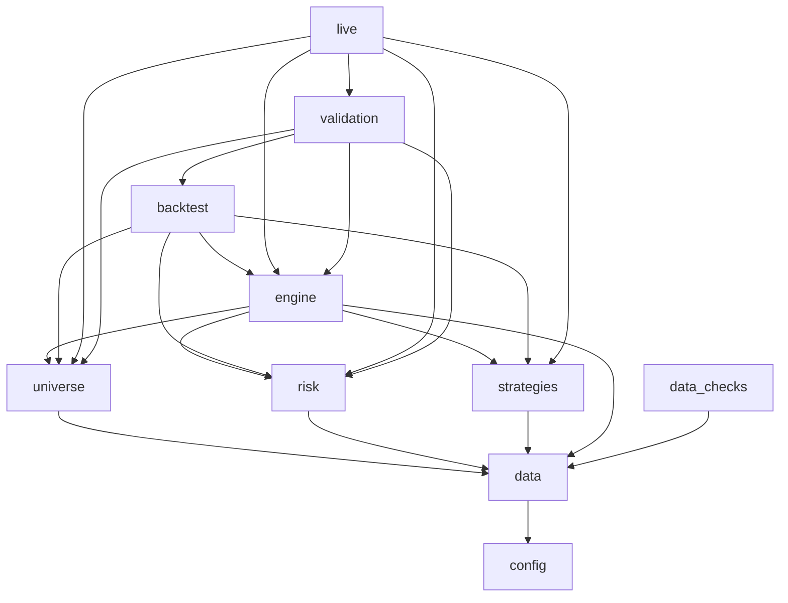
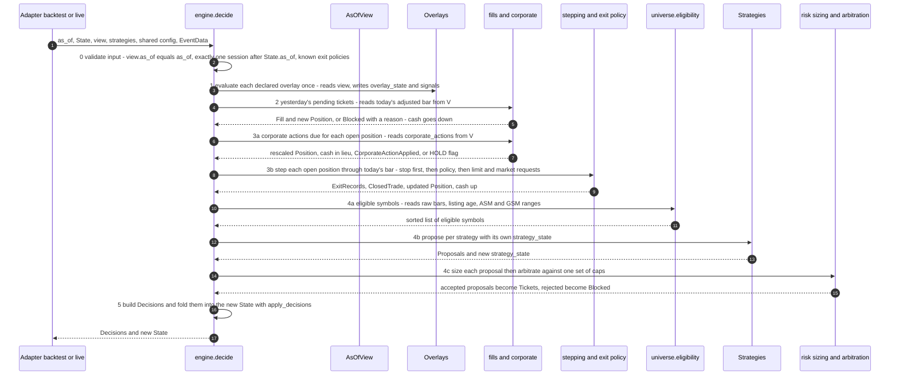
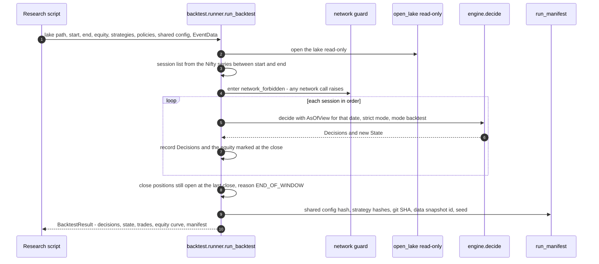
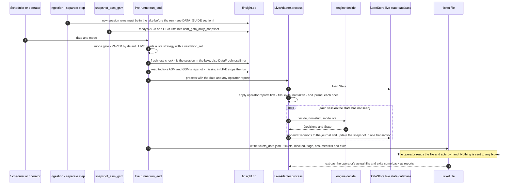
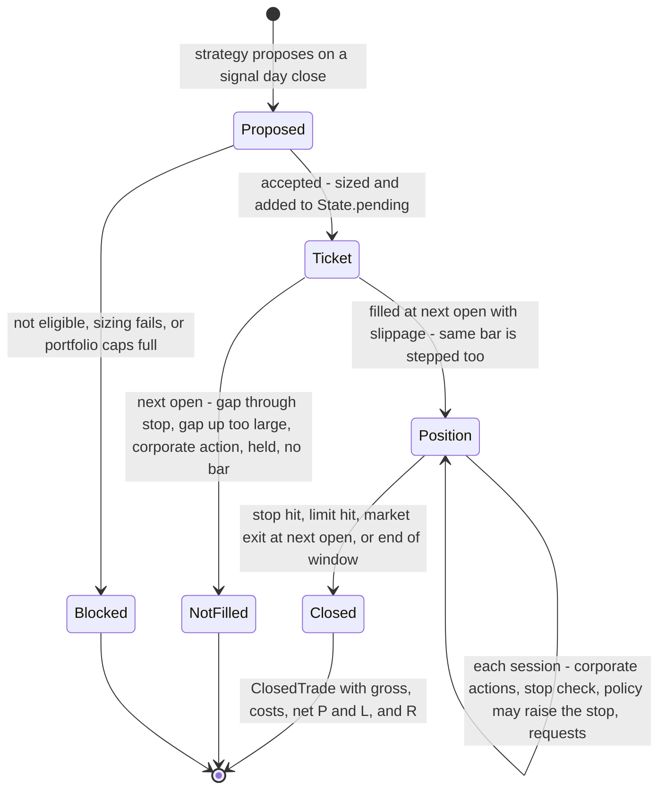
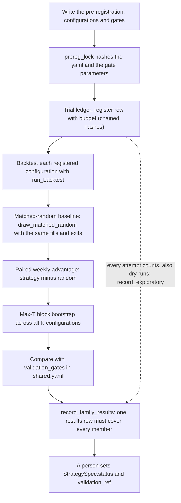
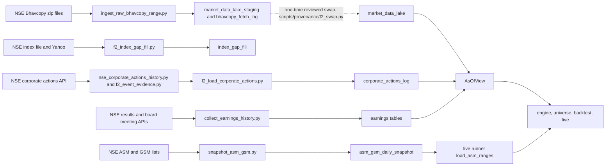
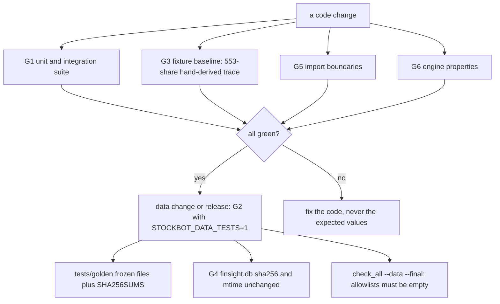

# StockBot codebase guide

A reading guide for the owner. It describes the repository as it is on `master` (tag `post-restructure`), written from the code, not from older documents. Plain words first, exact names after. Nothing here is a recommendation and nothing here describes a strategy: **no strategy exists in the tree.**

A picture version, for reading by clicking instead of scrolling, is `docs/guides/codebase_guide.html` (open it from the folder; it needs no internet). This text stays the detailed reference.

How to keep it honest: `tests/unit/test_guides_consistent.py` fails if a package, module or script is missing from this guide, or if a file path named in it does not exist. The companion guide for the database is `docs/guides/DATA_GUIDE.md`.

Contents: A overview, B repo map, C packages, D scripts, E tests, F other folders, G how a strategy plugs in, H configuration, I diagrams, J glossary, K "where do I look when...".

---

## A. One-page overview

**What it is.** A local, end-of-day research and decision-support system for Indian equities. Once a day, after the market closes and the day's prices are in the database, it can look at the market as it stood at that close and write out a short file of **trade tickets**: "buy this many shares of X tomorrow at the open, with a stop at Y". A human reads the tickets and decides whether to act.

**What it is not.** It never sends an order. There is no broker connection and no order-routing code anywhere. `tests/unit/test_regulatory_barrier.py` scans all of `stockbot/` and `scripts/` for broker or order code and fails the build if it finds any. Trading rules in India (SEBI) are the reason: the program is a decision aid, not an algorithm that trades.

**The one rule.** *A strategy only proposes. Everything else is shared.* A strategy answers one question: "given what is known at today's close, which stocks would I like to buy, and where would my stop be?". It never sees a database connection, the clock, the portfolio, other strategies, the costs, or the future. Everything that makes a proposal real is shared code that every strategy gets identically: which stocks are even eligible (universe rules), how many shares (sizing), whether the portfolio has room (risk caps and arbitration), the fill at the next open, the stop and exit stepping, the corporate-action handling, the costs, and the validation gates.

**Why it is built this way.** So that a result cannot flatter a strategy by accident. The same decision function runs in a backtest and in the live end-of-day run; the data view cannot return a bar after the date being decided; the validation counts every attempt in a tamper-evident ledger. Results from two different strategies are then comparable because only the proposal step differs.

**State of the tree.** The machinery is finished and strategy-independent. The old strategy was tested, rejected and removed (it lives in git tag `pre-restructure`). The registry is empty (`stockbot.strategies.registry.default_registry`), the live "book" is empty (`stockbot.live.runner.default_book`), so a daily run today processes sessions and produces no tickets (once the day's data is in the lake; see I.7). `tests/unit/test_no_strategy_in_the_tree.py` keeps it that way.

---

## B. Map of the repository

```
StockBot/
  stockbot/      all application code (ten packages, see section C)
  scripts/       thin command-line wrappers; scripts/provenance = one-off tools kept as history
  tests/         unit, integration, data_integrity (real database), fixtures, golden (frozen results)
  docs/          architecture, data and validation docs, data_audit reports, restructure record, guides (this file)
  data/          reference/ (small csv inputs the code reads) and f9/ (power-study results)
  backtest/      RESULT FILES ONLY from the rejected old search (no code)
  ui/            React dashboard (not touched by the restructure)
  state/         created at the first run: live state database and ticket files (git-ignored)
  Claude_Docs/   reports written for the reviewer after each stop (tracked in git)
  README.md  pytest.ini  requirements.txt
```

| folder | what it is |
|---|---|
| `stockbot/` | The program. Ten packages with strict import rules (section C). |
| `scripts/` | One file per command you can type. Each is a few lines that call a function inside `stockbot/` (section D). `scripts/provenance/` holds old one-off tools that produced numbers older reports cite. |
| `tests/` | The checks that keep the rules true (section E). `tests/golden/` holds results frozen from the old code. `tests/fixtures/` holds synthetic lakes and dummy strategies used only by tests. |
| `docs/` | Written records. `docs/ARCHITECTURE.md` (layers), `docs/restructure/` (the restructure record: engine contract, pre-live list, removed tests), `docs/data_audit/` (data reports and the known-issues file), `docs/guides/` (these guides). |
| `data/` | `data/reference/` (csv files the code reads, section F and DATA_GUIDE section H) and `data/f9/` (results of the power study). |
| `backtest/` | Result files kept on purpose: `backtest/outputs/selection_decision.json` and `backtest/outputs_recomputed_net/`. See `backtest/README.md`. |
| `ui/` | The React dashboard source (Vite, TypeScript, Tailwind). |
| `state/` | Does not exist until the first end-of-day run: then `state/live_state.db` and `state/tickets/`. Git-ignored (`.gitignore`). |
| `Claude_Docs/` | Reports to the reviewer (`STOCKBOT_RESTRUCTURE_STOP1_REPORT.md` ... and so on). |

Outside the repository (not in git): `finsight.db` (the price database, in the repository folder but ignored by git), `F:\Projects\Ravi\Backups\` (database backups) and `F:\Projects\Ravi\StockBotSnapshot\` (a frozen stand-alone ASM/GSM snapshot tool and its own small database). Details in DATA_GUIDE section A.

---

## C. The packages

### C.0 Which package may import which

These are the rules enforced by `tests/unit/test_import_boundaries.py` (rule table in `tests/fixtures/boundaries.py`). An import that breaks them fails the build; seeded violations in `tests/fixtures/boundary_violations/` prove the test can fail.

| package | may import | may NOT import |
|---|---|---|
| `stockbot.config` | nothing from `stockbot` | everything |
| `stockbot.data` | config | all others |
| `stockbot.universe` | config, data | risk, engine, strategies, backtest, live, validation |
| `stockbot.risk` | config, data | universe, engine, strategies, backtest, live, validation |
| `stockbot.engine` | config, data, universe, risk, strategies (only `strategies.base` and registry) | backtest, live, validation |
| `stockbot.strategies` | data (view types only) | everything else |
| `stockbot.backtest` | config, data, universe, risk, engine, strategies | live, validation |
| `stockbot.live` | config, data, universe, risk, engine, strategies, validation | backtest |
| `stockbot.validation` | config, data, risk, backtest, engine, universe | live, strategies |
| `stockbot.data_checks` | config, data | all others |

Extra rules in the same test: no strategy imports another strategy; `backtest`, `engine`, `strategies` and `risk` may not import a network library (`requests`, `urllib`, `yfinance`, `socket` ...); `engine` and `strategies` may not import `sqlite3` or `sqlalchemy` (they can never hold a database connection); nothing in `stockbot/` edits `sys.path`; nothing imports the old top-level modules. `live` importing `validation` is a temporary edge (it exists only because the old dashboard routers use trade-metrics reporting): it must disappear when the routers are reworked, see `docs/restructure/PRE_LIVE_LIST.md` item 7. `tests/unit/test_every_module_imports_alone.py` checks that every module imports in a fresh interpreter.

### C.1 `stockbot.config`

**Meaning.** Where settings and file locations come from. Imports nothing else from the program.

| module | purpose |
|---|---|
| `shared.py` | Typed, validated shared configuration (dataclasses per section). `load_shared_config()` reads `shared.yaml`. |
| `shared.yaml` | The one configuration file: runtime mode, execution assumptions, costs, portfolio risk, universe rules, validation gates, paper criteria. |
| `paths.py` | The only place that knows where files live: the lake, the state database, the ticket folder. |
| `mode.py` | `current_mode(config)`: resolves PAPER or LIVE from a config dictionary. |
| `dict_view.py` | `config_dict()`: the shared config as the plain nested dictionary that older code (ingestion, quality checker, API routers, paper report) was written for. |
| `logging_config.py` | JSON-lines logging set-up (`setup_logging`). |

- **Reads:** `shared.yaml`; environment variables `STOCKBOT_DB`, `STOCKBOT_STATE_DB`, `STOCKBOT_TICKETS_DIR`. **Writes:** nothing (logging writes under `logs/` when used). **Called by:** almost every package.
- **Main API:** `load_shared_config(path=None) -> SharedConfig`; `parse_shared_config(raw) -> SharedConfig`; `lake_path()`, `state_db_path()`, `tickets_dir()`, `repo_root()` (all return `Path`); `config_dict(cfg=None) -> dict`; `current_mode(config) -> str`.

### C.2 `stockbot.data`

**Meaning.** Everything about market data: how it is fetched and stored (ingestion), how it is read safely (the lake opener and the as-of view), how prices are adjusted for splits and bonuses (in memory only), and shared indicators. This is the only package that talks to the database file or the network for data.

| module | purpose |
|---|---|
| `lake.py` | `open_lake`: opens `finsight.db` read-only (SQLite `mode=ro` plus `query_only`), so a write raises an error. |
| `asof.py` | `AsOfView`: the point-in-time window onto the lake. The only way code above `data` reads market data. |
| `adjustments.py` | Pure functions that adjust raw prices for splits and bonuses, and compute ADTV. Never touches the database. |
| `indicators.py` | Pure indicator functions: `sma`, `rma`, `atr`, `donchian_low`, `donchian_high`. |
| `sector_map.py` | `sector_for(symbol)`: sector lookup from `data/reference/sector_map.csv`. |

Subpackage `stockbot.data.db` (the older, ORM layer used by the dashboard side; writes to `finsight.db`):

| module | purpose |
|---|---|
| `connection.py` | SQLAlchemy engine and `get_session()`; `init_db()` runs `schema.sql`. Uses `DATABASE_URL` (default `sqlite:///./finsight.db`, relative to the folder you run from). |
| `models.py` | ORM classes for the older tables (`MarketDataLake`, `CorporateActionsLog`, `ActivePosition`, `TradeAnalyticsLog` ...). |
| `schema.sql` | `CREATE ... IF NOT EXISTS` statements for the original tables, triggers and indexes. |

Subpackage `stockbot.data.ingestion` (the only code that writes market data into the database or fetches from NSE and other sources; none of it is imported by the engine, backtest or live decision code):

| module | purpose |
|---|---|
| `ingest_raw_bhavcopy_range.py` | Downloads NSE Bhavcopy (end-of-day price files) for a date range into `market_data_lake_staging` and logs each date in `bhavcopy_fetch_log`. Never writes to `market_data_lake`. Resumable. |
| `bhavcopy_ingestor.py` | `BhavcopyIngestor`: ORM-style loader that inserts EQ rows into `market_data_lake`. No script or module calls it today. |
| `ohlcv_ingestor.py` | `OHLCVIngestor`: older per-symbol raw price ingestion from the Zerodha Kite Connect API into `market_data_lake`. No script calls it today. |
| `index_vix_ingestor.py` | `IndexVIXIngestor`: older Nifty 50 / India VIX ingestion via Kite Connect into `market_data_lake`. No script calls it today. |
| `base_ingestor.py` | `BaseIngestor`: shared base class (retries, rate limiting) of the older ingestors. |
| `f2_index_gap_fill.py` | Fills missing Nifty and VIX dates from NSE's daily index file into `index_gap_fill`. |
| `f2_index_gap_fill_yahoo.py` | Yahoo fallback for index dates the NSE file does not cover. |
| `nse_corporate_actions_history.py` | Downloads corporate-action history per symbol from the NSE API into a csv and parses the subject text into ratios. |
| `f2_event_evidence.py` | Assigns an evidence tier to every corporate-action event (read-only on the database). |
| `ca_evidence.py` | The evidence-tier rules (`classify`, `best_pair`, `nearest_standard`). |
| `f2_load_corporate_actions.py` | Append-only load of verified events into `corporate_actions_log`. |
| `corporate_actions_ingestor.py` | `CorporateActionsIngestor`: older corporate-action fetcher (Kite, then the NSE API). It only logs events. No script calls it today. |
| `lake_symbols.py` | `lake_symbol(...)`: resolves which lake symbol a corporate-action event belongs to. |
| `f2_build_isin_symbol_map.py` | Builds the deterministic ISIN-to-symbol map (`isin_symbol_map`). |
| `f2_build_fund_symbols.py` | Lists ETF / fund symbols (ISIN starting INF) to `data/reference/fund_etf_symbols.csv`. |
| `securities_ingestor.py` | Loads the NSE list of listed securities into `securities_master`. |
| `shares_outstanding_ingestor.py` | `SharesOutstandingIngestor`: older shares-outstanding fetcher (Kite instruments list and other sources); the table's rows actually came from `scripts/provenance/fix_blocker2_shares_outstanding.py` (Yahoo, not point-in-time, KI-001). |
| `collect_earnings_history.py` | Collects results-announcement history from two NSE APIs into the `earnings_*` tables. |
| `earnings_calendar_ingestor.py` | `EarningsCalendarIngestor`: older earnings calendar from the NSE corporate-actions API into `earnings_calendar`. No script calls it today. |
| `asm_gsm_refresher.py` | `ASMGSMRefresher`: older ASM/GSM list refresher (replaces the whole table each time) into `asm_gsm_list`. No script calls it today. |
| `snapshot_asm_gsm.py` | Forward daily snapshot of NSE's ASM and GSM lists into `asm_gsm_daily_snapshot`, `asm_gsm_snapshot_raw`, `asm_gsm_snapshot_log`. |
| `merge_asm_gsm_snapshots.py` | Merges the stand-alone snapshot database into `finsight.db`. |
| `local_csv_ingestor.py` | `ingest_all()`: loads local csv files (older set-up tool). |

- **Reads:** the lake (read-only through `lake.py`); NSE and other web sources (ingestion only); `data/reference/*.csv`. **Writes:** only the ingestion modules and `stockbot.data.db` write `finsight.db`; `lake.py`, `asof.py`, `adjustments.py`, `indicators.py` never do. **Called by:** `asof.py` and `lake.py` by engine, universe, backtest, live, validation, data_checks; ingestion by the scripts in section D.
- **Main API:**
  - `open_lake(path=None) -> sqlite3.Connection`
  - `AsOfView(conn, as_of)` with `raw_bars`, `adjusted_bars`, `raw_close`, `traded_value`, `adtv(symbol, period=20)`, `index_bars`, `corporate_actions`, `sessions(lookback=None)`, `earnings_coverage`, `results_meetings`, `symbols_trading()`, `symbol_info`; raises `FutureDataError` for a request after `as_of`
  - `get_adjusted_series(raw_ohlcv, corporate_actions, as_of_date) -> DataFrame`; `compute_row_factors(index, corporate_actions, as_of_date)`; `compute_adtv(raw_close, raw_volume, period=20)`; `compute_market_cap(raw_close, shares_outstanding)`
  - `atr(high, low, close, period=14)`, `sma(series, period)`, `donchian_high(high, period=252)`, `donchian_low(low, period=20)`

### C.3 `stockbot.universe`

**Meaning.** The shared rules for "which stocks may a strategy even look at today".

| module | purpose |
|---|---|
| `eligibility.py` | `eligible_symbols`: not a fund/ETF, 20-session ADTV above the minimum, old enough, not under ASM/GSM today. `results_within`: is a known results meeting due within N days. |
| `exclusions.py` | `Exclusions`: an older fail-closed loader of surveillance and earnings exclusion files (used only by a test today). |

- **Reads:** only through an `AsOfView` it is given. **Writes:** nothing. **Called by:** `stockbot/engine/decide.py` and `stockbot/validation/random_baseline.py`.
- **Imports:** config, data only. The market-cap gate is parked and is not applied (known issue KI-001 in `docs/data_audit/DATA_KNOWN_ISSUES.md`).
- **Main API:** `eligible_symbols(view, universe_cfg, *, overrides=None, asm_ranges=None, adtv_period=20) -> list`; `results_within(view, symbol, days) -> Optional[bool]` (`None` means "no earnings data", never "no event").

### C.4 `stockbot.risk`

**Meaning.** Position sizing, portfolio limits, costs and the definition of R. Pure arithmetic; no strategy knowledge.

| module | purpose |
|---|---|
| `sizing.py` | `size_position`: shares = floor(equity x risk % / (entry - stop)), optionally capped by cash. |
| `caps.py` | Three caps checked on projected post-trade values: number of positions, total portfolio risk %, sector exposure %. |
| `arbitration.py` | Admits proposals from several strategies against one set of caps in a fixed order; blocks a symbol already held. |
| `costs.py` | `CostModel`: brokerage-free Indian cost stack (STT, exchange fees, SEBI fee, stamp duty, GST, DP charge, tax). |
| `r_metrics.py` | The single definition of R (risk per trade, gross R, net R, after-tax R). |

- **Reads:** numbers passed in. **Writes:** nothing. **Called by:** `stockbot/engine/decide.py`, `stockbot/engine/fills.py`, `stockbot/engine/stepping.py`, `stockbot/validation/random_baseline.py`.
- **Main API:**
  - `size_position(*, equity, risk_pct, entry, stop, cash=None) -> SizeResult`
  - `check_caps(*, limits, equity, open_positions, sector, position_value, risk_amount, max_positions=None) -> Optional[str]`; `caps_full(...)`; `CapLimits(max_positions, max_total_risk_pct, max_sector_pct)`
  - `arbitrate(proposals, *, limits, equity, open_positions=(), max_positions=None) -> list[Decision]`; `admission_order(proposals) -> list`
  - `CostModel.from_shared(costs)`; `.buy_cost(value)`, `.sell_cost(value)`, `.tax_on_gain(net_gain)`
  - `compute_trade_r(*, entry_price, stop, shares_initial, pnl_gross, pnl_net, tax_est=0.0) -> dict`; `add_r_columns(df)`

### C.5 `stockbot.engine`

**Meaning.** The heart. One pure function, `decide`, that takes "the state of the portfolio after yesterday" plus "the market as of today's close" and returns "what happened today and what to do tomorrow". Backtest and live both call it. *Pure* means: it has no database, network, clock or randomness of its own, so the same inputs always give the same outputs.

| module | purpose |
|---|---|
| `decide.py` | `decide`: the one decision function for one session (steps in diagram I.2). |
| `types.py` | Plain frozen data types: `Position`, `Ticket`, `Fill`, `ExitRecord`, `ClosedTrade`, `Blocked`, `Flag`, `State`, `Decisions` (with lossless JSON). |
| `apply.py` | `apply_decisions(state, decisions) -> State`: folds a session's decisions into the state. |
| `fills.py` | `fill_ticket`: the shared fill rule (next open, gap rules, slippage, sizing from the fill price). |
| `stepping.py` | `step_position`: advances one open position through one bar in one fixed order (market exit, stop, policy, limit and market requests). |
| `exit_policy.py` | The exit-policy interface and its small data types (`Bar`, `MarketAtNextOpen`, `Limit`, `StepContext`, `PolicyActions`, `ExitPolicy`). |
| `corporate.py` | Splits and bonuses on open positions: rescale prices and shares, cash for fractions; anything else puts the position on HOLD. |
| `reports.py` | Operator reports in live (`FillReport`, `ExitReport`, `NotTakenReport`) turned into `ReportEffect`s that change the state. |
| `path.py` | `simulate_ticket`: one position's path under the same fill and stepping rules (used by the matched-random baseline). |

- **Reads:** the `AsOfView` it is handed, the shared config, the `State`. **Writes:** nothing outside its return value. **Called by:** `stockbot/backtest/runner.py`, `stockbot/live/adapter.py`, `stockbot/validation/random_baseline.py`, tests.
- **Imports:** config, data, universe, risk, `strategies.base`/registry; no network, no `sqlite3`.
- **Main API:**
  - `decide(as_of, state, view, strategies, shared_config, event_data, *, policies, overlays=None, strict=True, mode="backtest") -> tuple[Decisions, State]`
  - `EventData(sectors, asm_ranges)`; `EngineInputError`; `bar_of(view, symbol) -> Optional[Bar]`
  - `apply_decisions(state, d) -> State`; `State.initial(cash)`, `State.to_json()`, `State.from_json(s)`; `Decisions.to_json()`, `Decisions.from_json(s)`
  - `step_position(pos, bar, day, view, policy, costs, exit_slippage_pct, overlays=None) -> StepOutcome`
  - `fill_ticket(t, bar, day, *, execution, risk_pct, equity, cash, costs, policy_id, held, corporate_action_today, confirm, initial_exit_state) -> FillPlan`
  - `simulate_ticket(t, sessions, view_at, *, shared_config, policy, equity, cash=None, confirm=...) -> tuple`
  - `fill_effect`, `exit_effect`, `not_taken_effect`, `apply_effect` (reports)

### C.6 `stockbot.strategies`

**Meaning.** The interface a strategy must satisfy, its description (`StrategySpec`) and a registry. **There are no strategy files here.** A strategy would live in its own module in this package and import only the interface.

| module | purpose |
|---|---|
| `base.py` | `Proposal`, and the `Strategy` and `Overlay` protocols. |
| `spec.py` | `StrategySpec` (identity, parameters, exit policy, status, references) with strict validation and a configuration hash. |
| `registry.py` | `StrategyRegistry` and the (empty) `default_registry`. |

- **Reads/writes:** nothing. **Called by:** the engine and runner use the protocols; a future strategy module would import `base.py` and `spec.py`.
- **Imports:** data view types only. Standard library otherwise.
- **Main API:** see section G.

### C.7 `stockbot.backtest`

**Meaning.** Runs the engine over a date window on the read-only lake. It contains no decision logic.

| module | purpose |
|---|---|
| `runner.py` | `run_backtest`: one `decide` call per session in strict mode, then closes open positions at the end of the window. |
| `manifest.py` | `run_manifest`: records what is needed to reproduce a run (config hash, strategy hashes, git SHA, data snapshot id). |
| `no_network.py` | `network_forbidden()`: a guard that makes any network access raise `NetworkAccessError` during a run. |

- **Reads:** the lake (read-only). **Writes:** nothing (returns a `BacktestResult`). **Called by:** `validation` (results), tests, a future strategy-research script.
- **Imports:** config, data, universe, risk, engine, strategies; never live; no network libraries.
- **Main API:** `run_backtest(lake, start, end, initial_equity, strategies, policies, shared_config, event_data, *, overlays=None, state=None, seed=None) -> BacktestResult`; `network_forbidden()` (context manager); `run_manifest(*, shared_config, strategies, window, initial_equity, lake_path=None, ...) -> dict`.

### C.8 `stockbot.live`

**Meaning.** The daily end-of-day run, plus the older dashboard side. The new part is thin: check the data is fresh, apply the operator's reports, call `decide` once per unseen session, journal the result, write a ticket file. It never ingests data and never talks to a broker.

| module | purpose |
|---|---|
| `runner.py` | `run_eod`: mode gate (PAPER default; LIVE needs a strategy with status live and a validation_ref), freshness check, ASM/GSM data, adapter, ticket files. |
| `adapter.py` | `LiveAdapter`: loads the state, applies reports first, calls `decide` once per missed session (non-strict), journals everything; idempotent per date. |
| `state_store.py` | `StateStore`: the separate live state database (`meta`, `journal`, `snapshot`), append-only journal with triggers, `rebuild()`. |
| `eod_cli.py` | Command line behind `scripts/run_eod.py`. Exit code 0 processed, 2 refused, 1 error. |
| `scheduler.py` | APScheduler job that calls `run_eod` once a day (19:00 IST while `data.eod_source` is `bhavcopy`). |
| `health_check.py` | `check`: read-only daily health check (stale data, snapshot versus journal, state behind the lake, unreconciled items). |
| `main.py` | FastAPI application: starts the scheduler and serves the dashboard API. |
| `paper_report.py` | Weekly paper-trading report against the paper criteria (reads the older tables). |
| `account_ledger.py` | Live equity from the older `account_ledger` table. |
| `equity.py` | Paper versus live equity and cash from the older tables. |
| `position_service.py` | Opens a position row in the older `active_positions` table. |
| `analytics_loop.py` | Writes closed trades to the older `trade_analytics_log` and a decay report. |
| `idempotency.py` | `IdempotencyGuard` for the older `pipeline_run_log` (the new run is idempotent through the journal instead). |

Subpackage `stockbot.live.api` (FastAPI routers for the dashboard; they still use the older tables and are **not** connected to the new state store, see `docs/restructure/PRE_LIVE_LIST.md` item 7): `analytics.py`, `health.py`, `ledger.py`, `portfolio.py`, `positions.py`, `regime.py`, `watchlist.py`.

- **Reads:** the lake (read-only), the state database, `asm_gsm_daily_snapshot`, `data/reference/sector_map.csv`. **Writes:** `state/live_state.db`, `state/tickets/tickets_<date>.json`; the older dashboard modules write the legacy tables of `finsight.db`. **Called by:** `scripts/run_eod.py`, `scripts/daily_health_check.py`, `scripts/paper_report.py`, `python -m stockbot.live.main`.
- **Imports:** config, data, universe, risk, engine, strategies, validation; never backtest; no module imports ingestion, `requests` or `yfinance` for decisions.
- **Main API:**
  - `run_eod(*, cfg, book, as_of=None, store=None, lake=None, out_dir=None, reports=(), mode=None, today=None) -> RunResult`
  - `LiveAdapter(store, lake, strategies, policies, shared_config, event_data, *, overlays=None)`; `.process(as_of, reports=()) -> list`
  - `StateStore(path)`: `initialise(cash)`, `append_effect`, `append_decisions`, `has_effect`, `decisions_for`, `journal_count`, `load()`, `rebuild()`
  - `Book(strategies, policies, overlays)`; `default_book()`; `strategies_for_mode(book, mode)`; `check_freshness(conn, as_of)`; `load_asm_ranges(conn, as_of)`; `write_tickets(dec, directory)`
  - errors: `ModeError`, `DataFreshnessError`, `SurveillanceDataMissing`, `ReportError`

### C.9 `stockbot.validation`

**Meaning.** How a strategy's results are judged and how attempts are counted: a matched-random baseline ("what would equally exposed random entries have earned under identical rules?"), paired statistics, the multiple-testing bootstrap (Max-T), the power study of that bootstrap, the pre-registration lock, and the trial ledger.

| module | purpose |
|---|---|
| `random_baseline.py` | `draw_matched_random`: random entries matched to each actual trade, simulated with the same engine path. |
| `paired_stats.py` | `paired_statistics`: actual versus random, paired. |
| `max_t_bootstrap.py` | `WestfallYoungMaxTBootstrap`: stepdown Max-T studentized block bootstrap across K configurations. |
| `validate_max_t.py` | Size and power check of the Max-T procedure on simulated data (F9). |
| `f9_power_study.py` | Power study at portfolio level (F9). |
| `f9_report.py` | Applies the pre-registered decision rule to the power-study results and writes `docs/F9_POWER_RESULTS.md`. |
| `prereg_lock.py` | Hash lock for the pre-registration and the hash-chained ledger primitives. |
| `trade_metrics.py` | Trade and portfolio performance reporting (reads the older `trade_analytics_log`). |

Subpackage `stockbot.validation.ledger` (`__init__.py` holds the writers; the records are in `stockbot/validation/ledger/records/`): `trial_ledger.csv` (hash-chained), `trial_ledger_exploratory.csv` (a pinned sha256, never a chain), `pre_registered_configs.yaml`, and a family ledger created by the first `register_family` call.

- **Reads:** backtest results, trade tables, the ledger records. **Writes:** ledger rows (append-only, through `prereg_lock.append_row`), `docs/F9_POWER_RESULTS.md`. **Called by:** research scripts, `stockbot/live/paper_report.py`, tests.
- **Imports:** config, data, risk, backtest, engine, universe; never live.
- **Main API:** `register(*, ledger, yaml_path, gate_params, candidate_ids, git_sha, reason=None, now=None)`; `register_family(*, path, family_id, members, gate_params, git_sha, reason=None, now=None)`; `record_family_results(*, path, family_id, results, git_sha, reason=None, now=None)`; `record_exploratory(...)`; `verify(path=TRIAL_LEDGER) -> LedgerStatus`; `draw_matched_random(actual, *, sessions, view_at, shared_config, policy, equity, draws_per_trade, seed, pool_filter=None, asm_ranges=None) -> DataFrame`; `paired_statistics(actual_df, rand_df, *, seed) -> dict`; `WestfallYoungMaxTBootstrap(weekly_diffs, num_replications=10000, fwer_alpha=0.05, seed=42, block_size=4, sensitivity_block_sizes=None)` with `.run()` and `.run_sensitivity()`.
- **Honest note:** the validation gates in `shared.yaml` (`validation_gates`) are configuration values. No module compares a run against them yet; applying them to a strategy's result is part of the future strategy phase.

### C.10 `stockbot.data_checks`

**Meaning.** Read-only checks of the data and of the corporate-action handling, and the one entry point that runs all the golden checks.

| module | purpose |
|---|---|
| `check_all.py` | `py scripts/check_all.py [--data] [--final]`: runs G1, G3, G5, G6 (and G2 with `--data`) and prints G4's file size and mtime. |
| `data_catalogue.py` | Writes `docs/guides/data_catalogue.md` and, with `--json`, `docs/guides/data_catalogue.json`: machine-measured facts about every table (read-only). |
| `guide_html.py` | Builds `docs/guides/codebase_guide.html` (the interactive picture version of this guide) from `docs/guides/codebase_guide_data.json` and `docs/guides/codebase_guide_template.html`. Standard library only. |
| `data_guide_html.py` | Builds `docs/guides/data_guide.html` (the interactive picture version of `DATA_GUIDE.md`) from `docs/guides/data_guide_data.json`, the measured export `docs/guides/data_catalogue.json` and `docs/guides/data_guide_template.html`. Standard library only; reuses `guide_html.py`. |
| `copy_detector.py` | Flags dates whose rows copy the previous session (holiday copies). |
| `f2_engine_scan.py` | Post-adjustment scan of large price moves through the real adjustment path, via the as-of view. |
| `f2_verify_engine_path.py` | Runs every row of the verified-corporate-action list through the as-of view. |
| `f2_verify_list.py` | Adds result columns to `data/reference/verified_corporate_actions.csv`. |
| `f2_split_rename_links.py` | Finds symbol renames that coincide with an ISIN change at a split. |
| `earnings_coverage.py` | Earnings coverage by year and names with no data. |
| `earnings_validate.py` | Cross-source check of results broadcast dates versus board-meeting dates. |
| `preflight.py` | `assert_preflight_spot_check()`: spot checks of data and adjustments. |
| `preflight_spot_check.py` | Command-line runner for the preflight spot checks. |
| `quality_checker.py` | `DataQualityChecker`: OHLCV integrity and stale-data checks (ORM layer). |

- **Reads:** the lake (read-only), `data/reference/*.csv`, `tests/golden/`. **Writes:** report files under `docs/data_audit/` for some checks; `data_catalogue.py` writes `docs/guides/data_catalogue.md`. **Called by:** the scripts in section D.
- **Imports:** config, data only.

---

## D. Scripts

Every file in `scripts/` is a thin wrapper that calls one function inside `stockbot/`; the wrapper adds the repository to the Python path and runs the module. `tests/unit/test_script_wrappers_help.py` runs every wrapper with `--help` and checks that it answers and writes nothing. "Daily" means meant to run every trading day; no scheduled task for any of them exists on this machine (checked 2026-11-09: no StockBot task in Windows Task Scheduler).

| script | what it does | when | calls |
|---|---|---|---|
| `scripts/run_eod.py` | The end-of-day decision step for one date: mode gate, freshness check, decide, state store, ticket file. | daily | `stockbot.live.eod_cli` |
| `scripts/daily_health_check.py` | Read-only health check of the live side; exit 1 if something looks wrong. | daily | `stockbot.live.health_check` |
| `scripts/snapshot_asm_gsm.py` | Stores NSE's current ASM and GSM lists in `finsight.db` (point-in-time only from the first day it runs). | daily (intended) | `stockbot.data.ingestion.snapshot_asm_gsm` |
| `scripts/ingest_raw_bhavcopy_range.py` | Downloads Bhavcopy for a date range into the staging table. | manual | `stockbot.data.ingestion.ingest_raw_bhavcopy_range` |
| `scripts/check_all.py` | All golden checks. | manual | `stockbot.data_checks.check_all` |
| `scripts/gen_data_catalogue.py` | Regenerates `docs/guides/data_catalogue.md` from the database (read-only). | manual | `stockbot.data_checks.data_catalogue` |
| `scripts/build_data_guide_html.py` | Rebuilds `docs/guides/data_guide.html` from its JSON, the catalogue export and the template (`--stamp` first records today's date and the git commit). | manual | `stockbot.data_checks.data_guide_html` |
| `scripts/build_guide_html.py` | Rebuilds `docs/guides/codebase_guide.html` from its JSON and template (`--stamp` first records today's date and the git commit). | manual | `stockbot.data_checks.guide_html` |
| `scripts/paper_report.py` | Paper-trading criteria report. | manual | `stockbot.live.paper_report` |
| `scripts/preflight_spot_check.py` | Data and adjustment spot checks. | manual | `stockbot.data_checks.preflight_spot_check` |
| `scripts/earnings_coverage.py` | Earnings coverage report. | manual | `stockbot.data_checks.earnings_coverage` |
| `scripts/earnings_validate.py` | Earnings cross-source check. | manual | `stockbot.data_checks.earnings_validate` |
| `scripts/collect_earnings_history.py` | Collects earnings history from the NSE APIs (long run). | manual | `stockbot.data.ingestion.collect_earnings_history` |
| `scripts/merge_asm_gsm_snapshots.py` | Merges the stand-alone ASM/GSM snapshot database into `finsight.db`. | one-off | `stockbot.data.ingestion.merge_asm_gsm_snapshots` |
| `scripts/f2_copy_detector.py` | Finds holiday-copy dates. | one-off | `stockbot.data_checks.copy_detector` |
| `scripts/f2_engine_scan.py` | Large-move scan through the adjustment path; compares with the frozen result. | manual | `stockbot.data_checks.f2_engine_scan` |
| `scripts/f2_verify_engine_path.py` | The 57 verification rows through the as-of view. | manual | `stockbot.data_checks.f2_verify_engine_path` |
| `scripts/f2_verify_list.py` | Extends the verified corporate-action csv. | one-off | `stockbot.data_checks.f2_verify_list` |
| `scripts/f2_split_rename_links.py` | Rename and split link finder. | one-off | `stockbot.data_checks.f2_split_rename_links` |
| `scripts/f2_event_evidence.py` | Evidence tier for each corporate-action event. | one-off | `stockbot.data.ingestion.f2_event_evidence` |
| `scripts/f2_load_corporate_actions.py` | Append-only load of corporate actions into the log. | one-off | `stockbot.data.ingestion.f2_load_corporate_actions` |
| `scripts/f2_build_isin_symbol_map.py` | Builds the ISIN-to-symbol map. | one-off | `stockbot.data.ingestion.f2_build_isin_symbol_map` |
| `scripts/f2_build_fund_symbols.py` | Builds the ETF / fund symbol list. | one-off | `stockbot.data.ingestion.f2_build_fund_symbols` |
| `scripts/f2_index_gap_fill.py` | Fills missing Nifty and VIX dates from NSE. | one-off | `stockbot.data.ingestion.f2_index_gap_fill` |
| `scripts/f2_index_gap_fill_yahoo.py` | Yahoo fallback for index dates. | one-off | `stockbot.data.ingestion.f2_index_gap_fill_yahoo` |
| `scripts/f9_power_study.py` | Power study of the Max-T procedure. | one-off (done) | `stockbot.validation.f9_power_study` |
| `scripts/f9_report.py` | Applies the pre-registered decision rule to the power-study results. | one-off (done) | `stockbot.validation.f9_report` |
| `scripts/validate_max_t.py` | Size and power check of the Max-T bootstrap. | one-off (done) | `stockbot.validation.validate_max_t` |

### D.1 `scripts/provenance/` and why it is kept

These are one-off or superseded tools that produced numbers which reports under `docs/` cite (the F2 raw-price swap and its checks, the F2b point-in-time shares that were **not used**, the rejected six-configuration selection pipeline, the net-R recompute). They are not part of any run path; they import only `stockbot`, and each still imports. They are kept so a reader of an old report can find the code behind a number. `scripts/provenance/README.md` maps the old script paths to the new ones. Reports that cite a script that has since been deleted name the git tag `pre-restructure`.

| file | what it did |
|---|---|
| `scripts/provenance/f2_swap.py` | The reviewed swap of Yahoo-adjusted lake rows for raw NSE Bhavcopy rows (three transactions). |
| `scripts/provenance/f2_validate_staging.py` | Validation of the staging table before the swap. |
| `scripts/provenance/f2_pre2020_compare.py` | Compared pre-2020 lake rows with staging. |
| `scripts/provenance/f2_volume_continuity.py` | Checked volume units across the Bhavcopy format change. |
| `scripts/provenance/f2_eligibility_triage.py` | Triage of eligible names for the corporate-action work. |
| `scripts/provenance/f2_load_plan.py` | What would go into the corporate-action log and what the tiers do to prices. |
| `scripts/provenance/f2_move_dispositions.py` | Evidence and disposition for large moves that automation could not settle. |
| `scripts/provenance/f2_post_swap_checks.py` | Post-swap report writer. |
| `scripts/provenance/f2b_build_pit_shares.py`, `f2b_spotcheck.py`, `f2b_spotcheck_model.py`, `pit_shares.py` | Point-in-time shares attempt (F2b). **Not used**: it failed its pre-registered spot-check bar (KI-001). |
| `scripts/provenance/fix_blocker1_index_data.py` | One-off load of Nifty 50 and India VIX into the lake. |
| `scripts/provenance/fix_blocker2_shares_outstanding.py` | One-off fill of the `shares_outstanding` snapshot. |
| `scripts/provenance/ingest_historical_2018_2019.py` | The original 2018-2019 backfill. |
| `scripts/provenance/recompute_step3_net_r.py` | F1 net-R recompute of the old outputs. |
| `scripts/provenance/select_candidate.py` | The six-configuration selection pipeline that wrote the trial ledger. |
| `scripts/provenance/migrations/migration_phase2.py`, `migration_phase3_paper.py`, `migration_f3_corporate_actions.py`, `migration_securities_master.py` | Schema migrations already applied to `finsight.db` (paper-trading columns, the corporate-action hold columns, the securities master). |
| `scripts/provenance/regime/` | `regime_filter.py` and `regime_gates.py`: the old macro kill switch (Nifty below its 200-day average or VIX above 22, with a three-session re-entry rule). Not part of any run path and not an overlay yet; kept with their tests so the rule stays specified. |

---

## E. Tests

All tests are under `tests/` and run with pytest (`pytest.ini`). The "golden checks" are the named groups the project uses to prove nothing drifted.

| check | what it protects | where | command |
|---|---|---|---|
| **G1** unit and integration suite | Behaviour of every module on small synthetic data; no real database needed. | `tests/unit/`, `tests/integration/` | `py -m pytest tests/unit tests/integration -q` |
| **G2** real-database tests | The as-of view, corporate-action adjustment, calendar and frozen golden results behave correctly on the real lake (read-only). | `tests/data_integrity/` | `set STOCKBOT_DATA_TESTS=1` then `py -m pytest tests/data_integrity -q` |
| **G3** fixture-lake baseline | The engine reproduces a hand-derived trade on a small synthetic lake: fill 177.177, 553 shares, exit at stop x 0.999. | `tests/unit/test_g3_fixture_baseline.py` | `py -m pytest tests/unit/test_g3_fixture_baseline.py -q` |
| **G4** database unchanged | `finsight.db` has not been written: its sha256, size and modification time match the recorded baseline. | `docs/restructure/BASELINE.md` (hash), by hand | `check_all.py` prints size and mtime; hash with `sha256sum finsight.db` |
| **G5** import boundaries | The layer rules of section C.0, and that every module imports in a fresh interpreter. | `tests/unit/test_import_boundaries.py`, `tests/unit/test_every_module_imports_alone.py` | included in `check_all.py` |
| **G6** engine properties | Backtest and live give identical decisions; no look-ahead; idempotency; determinism; strategy isolation; baseline reuse; strict mode. | `tests/unit/test_engine_decide.py`, `test_engine_live.py`, `test_engine_backtest.py`, `test_engine_corporate.py`, `test_engine_types.py`, `test_risk_arbitration.py` | included in `check_all.py` |

`py scripts/check_all.py` runs G1, G3, G5, G6 and prints G4's size and mtime; `--data` adds G2; `--final` additionally requires the import-boundary allowlists to be empty.

**What an env-gated test is.** A test that is skipped unless an environment variable is set, because it needs the real 3.4 GB database or takes minutes. `STOCKBOT_DATA_TESTS=1` turns on the real-database tests (`tests/data_integrity/` and one check in `tests/unit/test_guides_consistent.py`); they open the database read-only and fail loudly if the file is missing. `STOCKBOT_FINAL_CHECK=1` turns on the "allowlists must be empty" check of the boundary test. Without the variables these tests report as skipped, not as passed.

**Other test folders.**
- `tests/golden/`: results frozen from the old code (120 as-of samples, the engine scan, the 57 verification rows, legacy equivalence) with `tests/golden/SHA256SUMS`; `tests/unit/test_golden_files.py` fails if one changes.
- `tests/fixtures/`: `synth_lake.py` and `mini_lake.py` (small synthetic lakes), `dummies.py` (dummy strategy, policy and overlay used only by tests), `boundaries.py` (import rules), `engine_run.py`, `golden.py`, `lakefile.py`.
- `tests/conftest.py`: shared fixtures.

---

## F. Other folders

- **`data/reference/`** (read by code and by checks; details per file in DATA_GUIDE section H): `sector_map.csv` (sector per symbol), `fund_etf_symbols.csv` (names excluded as funds), `isin_symbol_map.csv`, `special_sessions.csv`, `verified_corporate_actions.csv`, `unadjusted_events.csv`, `held_events.csv`, `corporate_actions_evidence.csv`, `nse_corporate_actions_raw.csv`, `EQUITY_L.csv`, `f2_symbols.txt`, `pit_shares_anchors.csv`, `pit_shares_spotcheck_filings.csv`. `data/f9/` holds the power-study results.
- **`docs/`**: `docs/ARCHITECTURE.md` (layers and flow), `docs/restructure/` (`ENGINE_CONTRACT.md` is the written specification of `decide`; `PRE_LIVE_LIST.md` is what must be done before any strategy goes live; `REMOVED_TESTS.md`; `BASELINE.md`), `docs/data_audit/` (reports and `DATA_KNOWN_ISSUES.md`), `docs/F9_PREREGISTRATION.md`, `docs/F9_POWER_RESULTS.md`, `docs/MAXT_VALIDATION.md`, `docs/ASM_GSM_SNAPSHOT.md`, `docs/EARNINGS_COLLECTION.md`, `docs/archive/` (old specifications), `docs/guides/` (these guides, the picture versions `codebase_guide.html` and `data_guide.html` with their `*_data.json` files, and the machine-measured `data_catalogue.md` and `data_catalogue.json`).
- **`backtest/`**: result files only, kept on purpose. `backtest/outputs/selection_decision.json` is the official decision of the rejected six-configuration search ("NONE": no candidate passed all gates). `backtest/outputs_recomputed_net/` holds the 27 files of the net-R recomputation of those six configurations. A folder `backtest/bifurcated_scraper/` may exist on your disk; it is git-ignored leftover from two invalid scrapers and is not part of the repository.
- **Ledgers** (`stockbot/validation/ledger/records/`): `trial_ledger.csv` is hash-chained so editing an old row is detectable (`verify_ledger`); `trial_ledger_exploratory.csv` has no chain and is pinned by a sha256 recorded in the restructure documents; rows are never edited. Their purpose is to count attempts: a result that survived many attempts is worth less, and the count is what the multiple-testing correction uses.
- **`ui/`**: the React dashboard. Pages `Dashboard.tsx`, `Portfolio.tsx`, `Watchlist.tsx`, `Analytics.tsx` call the FastAPI routers of `stockbot.live.api`. It was not touched by the restructure and is not connected to the new state store (`docs/restructure/PRE_LIVE_LIST.md` item 7). Start it with `cd ui && npm run dev`.

---

## G. How a strategy plugs in

Below is a **toy stub that exists only in this text**. It is not in the tree, proposes nothing sensible, and is shown only to name the pieces.

```python
# NOT A REAL STRATEGY - illustration only; do not add to the tree
from dataclasses import dataclass
from stockbot.strategies.base import Proposal
from stockbot.strategies.spec import StrategySpec

SPEC = StrategySpec(id="toy_example", version="0.1.0", params={"lookback": 20}, exit_policy="toy_exit",
                    status="research", prereg_ref=None, validation_ref=None)

class ToyStrategy:
    spec = SPEC
    def propose(self, view, eligible, as_of, strategy_state, overlays):
        out = []
        for sym in eligible:
            bars = view.adjusted_bars(sym, lookback=SPEC.params["lookback"])
            if len(bars) == SPEC.params["lookback"]:
                last = float(bars["close_adj"].iloc[-1])
                out.append(Proposal(SPEC.id, sym, as_of, reference_price=last, stop=last * 0.9, rank=0.0))
        return out, dict(strategy_state)
    def confirm_fill(self, proposal, fill_price, view):
        return None          # accept; return a reason string to reject
```

**`StrategySpec`** (`stockbot/strategies/spec.py`) describes a strategy and cannot override shared settings:

| field | meaning |
|---|---|
| `id` | lower-case name, 2 to 40 characters (`^[a-z][a-z0-9_]{1,39}$`) |
| `version` | `MAJOR.MINOR.PATCH` |
| `params` | the strategy's own parameters (JSON-serialisable); may not contain a shared section such as `costs` or `portfolio_risk` |
| `universe_overrides` | may only raise `min_adtv_cr` and `min_listing_age_trading_days`; the parked market-cap rule cannot be overridden |
| `exit_policy` | id of the exit policy it uses (required); the runner looks it up in the `policies` mapping |
| `status` | `research`, `paper` or `live` |
| `prereg_ref` | reference to the pre-registration record (optional) |
| `validation_ref` | reference to the validation record; **required when status is `live`** |
| `expected_trade_rate` | trades per month (optional, positive) |
| `smallest_edge_of_interest` | R per trade, net of costs (optional, positive) |
| `overlays` | overlay id to version the strategy declares (part of the hash) |

`config_hash()` is a sha256 of every field, so any change to a parameter changes the hash; the run manifest and the ledger record it.

**`Strategy` protocol** (`stockbot/strategies/base.py`): `propose(view, eligible, as_of, strategy_state, overlays) -> (proposals, new_strategy_state)` and `confirm_fill(proposal, fill_price, view) -> None or a reject reason`. A `Proposal` carries `strategy_id`, `symbol`, `signal_date`, `reference_price` (the signal-day close), `stop` (a price; shared code never derives one), optional `target`, `rank` (meaningful only within one strategy) and `metadata`. The strategy's own memory goes in `strategy_state` (plain data), never in an attribute.

**`ExitPolicy`** (`stockbot/engine/exit_policy.py`): `initial_state(position, view)`, `step(position, bar, view, ctx) -> PolicyActions` (a new stop, requested exits as `MarketAtNextOpen` or `Limit`, its own state) and `on_corporate_action(exit_state, factor)`. The policy decides *what*; the engine's `step_position` decides *how*, in one fixed order that is identical for every policy and for the random baseline. A stop can never move down.

**`Overlay`** (`stockbot/strategies/base.py`): `evaluate(view, overlay_state) -> (signal, new_overlay_state)`, evaluated once per session before anything else, for context such as a market-wide switch. A strategy declares which overlays it uses in `StrategySpec.overlays`; a missing or version-mismatched overlay raises `EngineInputError`. No real overlay exists yet (the old macro kill switch is kept as provenance).

**Registry** (`stockbot/strategies/registry.py`): `default_registry.register(spec)` rejects duplicate ids; `get`, `ids`, `all`. Today it is empty.

**Lifecycle and gates.**
- `research`: backtests only. `paper`: runs in PAPER mode in the live package. `live`: runs in LIVE mode; the spec cannot even be built without a `validation_ref`, and `strategies_for_mode` refuses LIVE with no live strategy.
- The status is a field a person sets; no code promotes a strategy. Evidence for a promotion is the trial ledger (every attempt registered), the matched-random baseline, the Max-T bootstrap, and the pre-registered gates in `shared.yaml` (`validation_gates`, `paper_criteria`).

---

## H. Configuration

All shared settings are in **`stockbot/config/shared.yaml`**, loaded and validated by `stockbot/config/shared.py` (unknown or missing keys fail loudly). A strategy cannot override any of it.

| section | what it holds |
|---|---|
| `runtime` | `mode` (PAPER or LIVE, **the only switch**; PAPER by default), `paper_start_equity` |
| `data` | `eod_source` (`bhavcopy`), ADTV period, symbol names of the Nifty and VIX series |
| `execution` | entry at the next open, entry and exit slippage %, maximum entry gap-up % |
| `costs` | STT, exchange fee, SEBI fee, stamp duty, GST, DP charge, short-term tax % (0.0) |
| `portfolio_risk` | maximum loss per trade %, maximum concurrent positions, maximum total portfolio risk %, maximum sector exposure % |
| `universe` | minimum market cap (parked, KI-001), minimum ADTV in crore, minimum listing age in trading days |
| `exclusions` | how many days ahead a results meeting counts as known |
| `live` | days before results at which an alert would apply (the alert itself is not built, pre-live item 8) |
| `backtest` | initial equity and the named date windows with roles TUNE and TEST |
| `validation_gates` | the pass criteria for a strategy's backtest (drawdown, alpha, expectancy, profit factor, minimum trades, tax, risk-free rate) |
| `paper_criteria` | the acceptance criteria for the paper run |

**What a strategy may set:** its own `params`, its exit policy, and (only upward) `min_adtv_cr` and `min_listing_age_trading_days`. **What it may not:** anything in the table above. `StrategySpec` validation rejects a shared section inside `params`, and `tests/unit/test_strategy_spec.py` checks that the list of protected sections equals the one in `shared.py`. Known differences between the shared values and the mandate (12 positions and 15% total risk versus 10 and 10) are listed in `docs/restructure/PRE_LIVE_LIST.md`.

Environment variables: `STOCKBOT_DB` (lake file), `STOCKBOT_STATE_DB`, `STOCKBOT_TICKETS_DIR`, `STOCKBOT_DATA_TESTS`, `STOCKBOT_FINAL_CHECK`, `DATABASE_URL` (older ORM layer), `LOG_LEVEL`.

---

## I. Diagrams

### I.1 Package dependencies



An arrow means "may import". Arrows to `config` from every package except `strategies` and the arrows into `data` from `universe`, `risk`, `engine`, `backtest`, `live`, `validation` are implied and omitted for readability; the table in C.0 is the complete list. Two one-way streets matter: `validation` may import `backtest` but `live` may not, and `live` may import `validation` (temporary) but `validation` may not import `live`.

### I.2 One `decide()` call for one session



Plain English: first the call is checked to be about exactly one day. Then yesterday's tickets are filled at today's open, open positions are adjusted for any split or bonus and walked through today's price bar (stop first), and only after that does each strategy look at the eligible stocks and propose. The proposals are sized and checked against the portfolio limits and become tomorrow's tickets. Everything that happened is returned as a `Decisions` record, and the new `State` is simply that record applied to the old one.

### I.3 A backtest run



Plain English: the backtest is only a loop. It asks the same `decide` the live run uses, one day at a time, with a view that cannot see tomorrow, and with the network switched off so the result can be reproduced from the database alone. At the end it closes whatever is still open and stamps the result with enough information to rerun it.

### I.4 Daily live or paper end-of-day run



Plain English: data arrives first by its own step; the run only checks that it is there. The operator's real fills and exits are applied before the engine thinks about the day, because reality overrides the engine's guess. Running the same date again changes nothing, because each date and each report can be journaled only once.

### I.5 Life of a position



Plain English: a proposal is only an idea until it is sized and fits the portfolio; then it is a ticket that waits one night. At the next open it is either filled (and immediately judged against that day's low, because a stop can be hit on the entry day) or dropped with a recorded reason. An open position is stepped every session and ends as a trade record. In live mode the operator's real fill or exit replaces the simulated one.

### I.6 Validation flow



Plain English: before looking at results, the configurations and the pass rules are written down and hashed, and the number of attempts is fixed in a tamper-evident ledger. Each attempt is compared with random entries that were run under identical rules, and the multiple-testing bootstrap adjusts for having tried several. Nothing in the code promotes a strategy automatically; the final status is set by a person using that evidence. The comparison against `validation_gates` is described by the pre-registration and done by the reader; no module evaluates the gates yet.

### I.7 Data ingestion flow (as the code stands)



Plain English: each source has its own script and its own table. The price tables reach the engine only through `AsOfView`. **A gap the diagram makes visible:** the range downloader writes only to the staging table, and the move from staging into `market_data_lake` was done once by a reviewed script (`scripts/provenance/f2_swap.py`). The older loader that inserts rows straight into the lake (`BhavcopyIngestor`) has no caller. So today nothing in `scripts/` appends a new session to `market_data_lake`, which the daily run's freshness check needs. See DATA_GUIDE section I.

### I.8 Testing and golden-check flow



Plain English: the quick checks run after every change; the real-database checks run at the end of a piece of work. The frozen golden files are results produced by the old code; the new code must reproduce them, and the rule is to fix the code, never to edit an expected value to make a test pass. G4 proves the checks themselves did not write to the database.

---

## J. Glossary

| term | meaning |
|---|---|
| **ticket** | A suggestion for the operator: symbol, planned shares, reference price, stop. Created at close T, filled (in the simulation) at the open of T+1. `Ticket` in `stockbot/engine/types.py`. |
| **session** | One trading day. The calendar is the dates of the Nifty 50 series in the lake (`AsOfView.sessions`). |
| **as-of** | The date a question is asked from. An `AsOfView(conn, as_of)` answers as the world looked at that day's close. |
| **PIT (point-in-time)** | Using only what was knowable on the as-of date. A value that is a single current snapshot (shares outstanding) is not PIT. |
| **ADTV** | Average daily traded value: raw close times raw volume, averaged over 20 sessions, in rupees (crore = 10 million). Always from raw, unadjusted prices. |
| **R** | The risk taken on a trade: shares times (entry minus initial stop). A profit of 2R is twice the amount risked. Gross R before costs, net R after, after-tax R after tax. Defined once in `stockbot/risk/r_metrics.py`. |
| **ex-date** | The first day a stock trades without the right to a corporate action (split, bonus, dividend). The log holds only ex-dates, not announcement dates. |
| **arbitration** | Admitting proposals from several strategies against one set of portfolio caps in a fixed, reproducible order; a symbol already held cannot be opened again. |
| **prereg (pre-registration)** | Writing the configurations and the pass rules down, and hashing them, before looking at results. |
| **ledger** | The append-only record of every attempt (`trial_ledger.csv`), hash-chained so an edit is detectable. |
| **HOLD** | A position the engine cannot rescale after a corporate action (merger, demerger, rights): it is flagged and excluded from trade statistics. |
| **overlay** | A shared signal evaluated before everything else (for example a market-wide switch), declared by the strategies that use it. |
| **ASM / GSM** | NSE's Additional and Graded Surveillance Measures lists. A name on today's list is excluded (fail-closed). |
| **lake** | `finsight.db`, the price database. |
| **State / Decisions** | `State` is the whole portfolio memory after a session; `Decisions` is what happened in a session. State is the fold of Decisions. |
| **idempotent** | Running it again with the same input changes nothing. |

---

## K. Where do I look when...

| situation | look at |
|---|---|
| a fill price looks wrong | `stockbot/engine/fills.py` (`fill_ticket`: open x (1 + entry slippage), gap rules), `execution` in `shared.yaml`; then the bar itself: `AsOfView.raw_bars` versus `adjusted_bars` |
| a stop was hit when it should not have been (or the reverse) | `stockbot/engine/stepping.py` (stop is checked against the bar's low, the entry bar included, no floor); corporate action on that date (`stockbot/engine/corporate.py`) |
| a symbol is missing from the eligible list | `stockbot/universe/eligibility.py` (fund, ADTV, listing age, ASM/GSM); `AsOfView.symbol_info`; whether the symbol traded that day (`symbols_trading`); DATA_GUIDE section D (EQ series only, renames) |
| prices jump in a way that looks like an error | `corporate_actions_log` for that symbol and ex-date (DATA_GUIDE section E); `data/reference/verified_corporate_actions.csv`; `scripts/f2_engine_scan.py` |
| the daily run did nothing | `py scripts/run_eod.py --help`; `DataFreshnessError` means the date is not in the lake yet; `ModeError` means LIVE with no live strategy; an empty book (`default_book`) means no tickets by design |
| the run says "REFUSED" | exit code 2 from `stockbot/live/eod_cli.py`: mode, freshness or missing ASM/GSM snapshot in LIVE |
| the live state looks wrong | `py scripts/daily_health_check.py`; `StateStore.rebuild()` must equal `load()`; `state/live_state.db` table `journal` |
| a ticket is missing from the file | `blocked` and `flags` in `state/tickets/tickets_<date>.json` give the reason for each blocked proposal |
| a number differs between backtest and live | they must not: `tests/unit/test_engine_live.py` compares decisions day by day; check `mode` and `strict` only |
| an import is refused by the build | `tests/unit/test_import_boundaries.py` and section C.0 |
| a test is skipped | it is env-gated: `STOCKBOT_DATA_TESTS=1` (real database) or `STOCKBOT_FINAL_CHECK=1` |
| I need to know what is in a table | DATA_GUIDE section C and `docs/guides/data_catalogue.md` |
| the database may have been written | G4: `sha256sum finsight.db` against `docs/restructure/BASELINE.md`; `py scripts/check_all.py` prints size and mtime |
| what was deliberately left undone before live | `docs/restructure/PRE_LIVE_LIST.md` |
